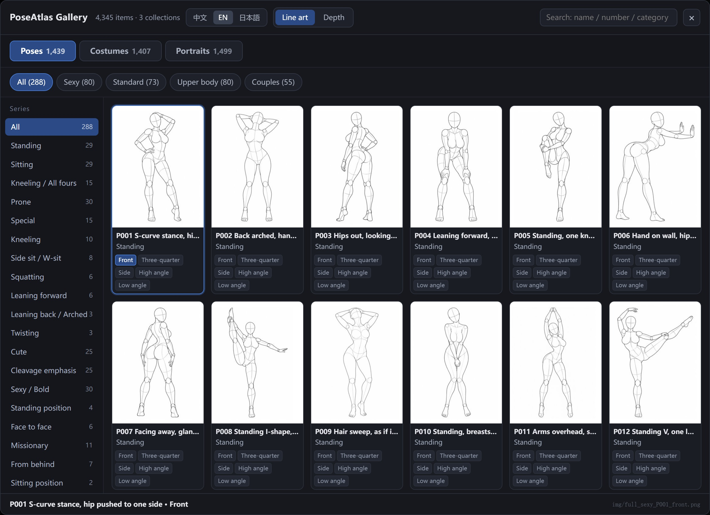
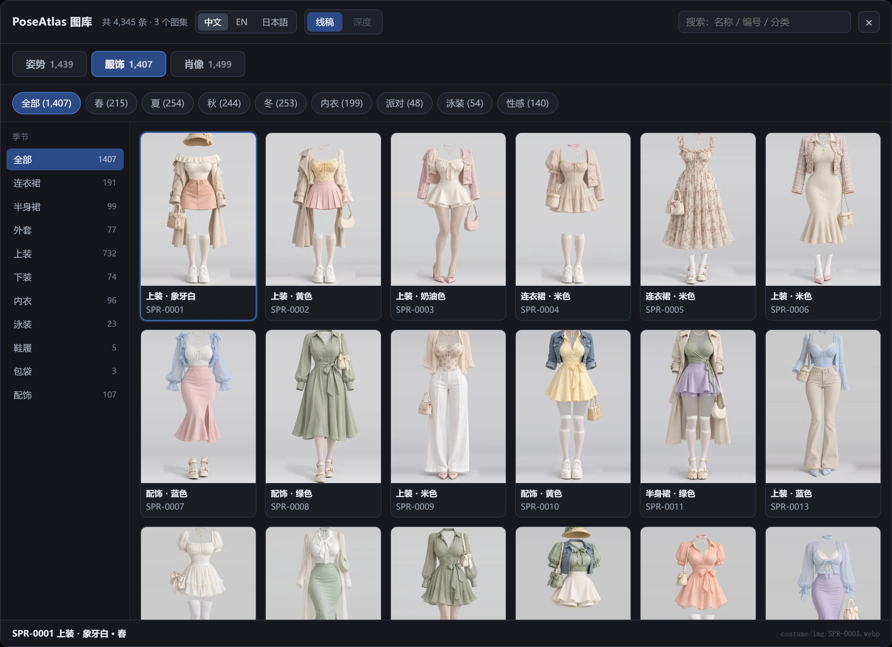
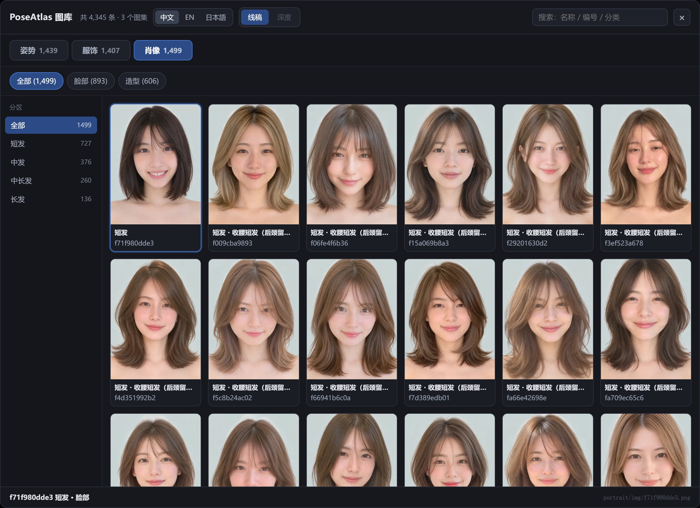
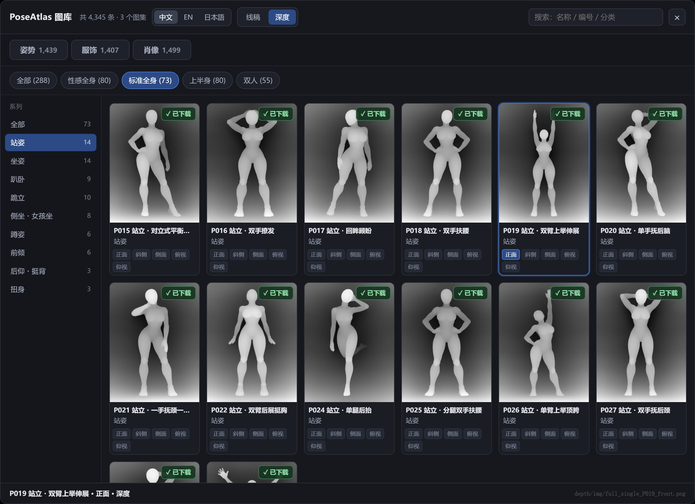
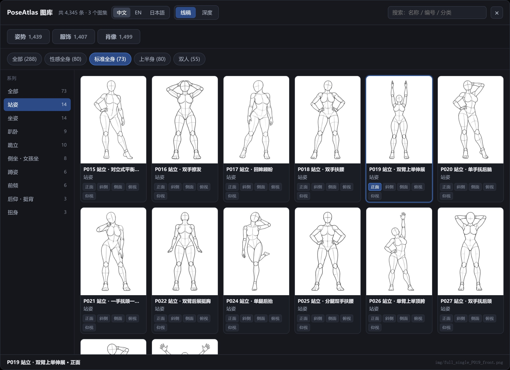
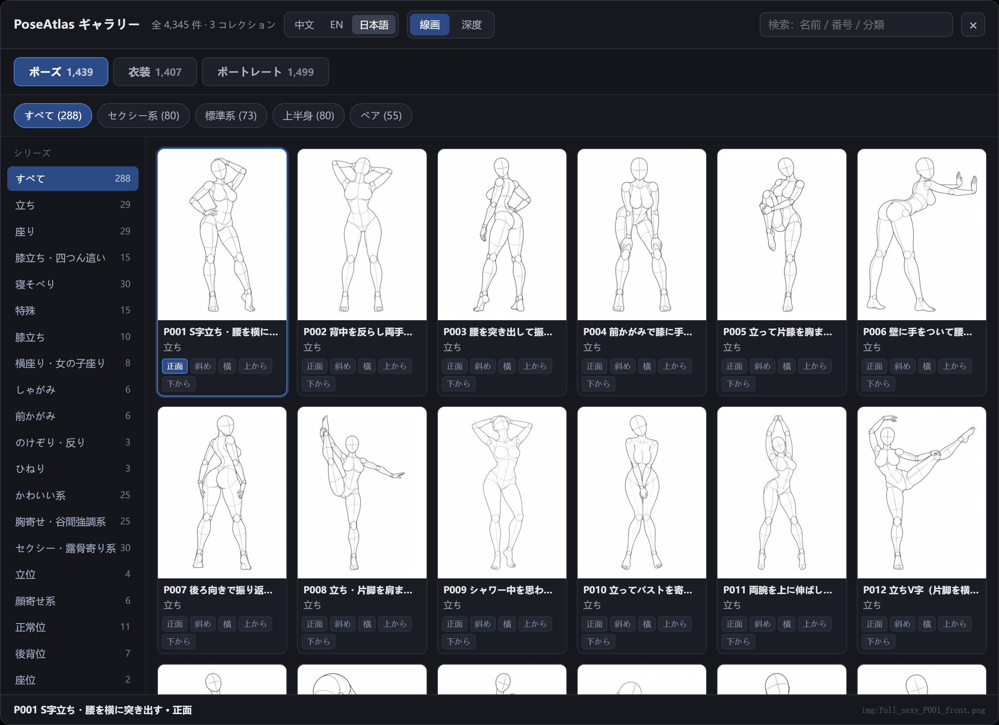
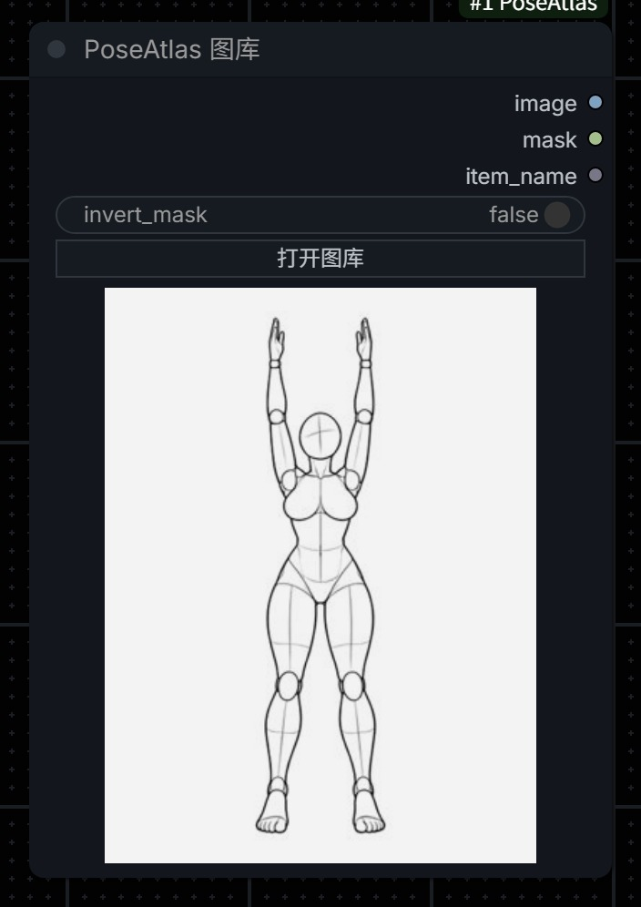
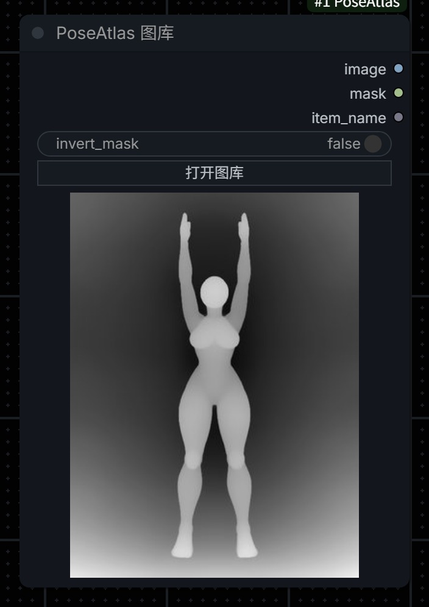
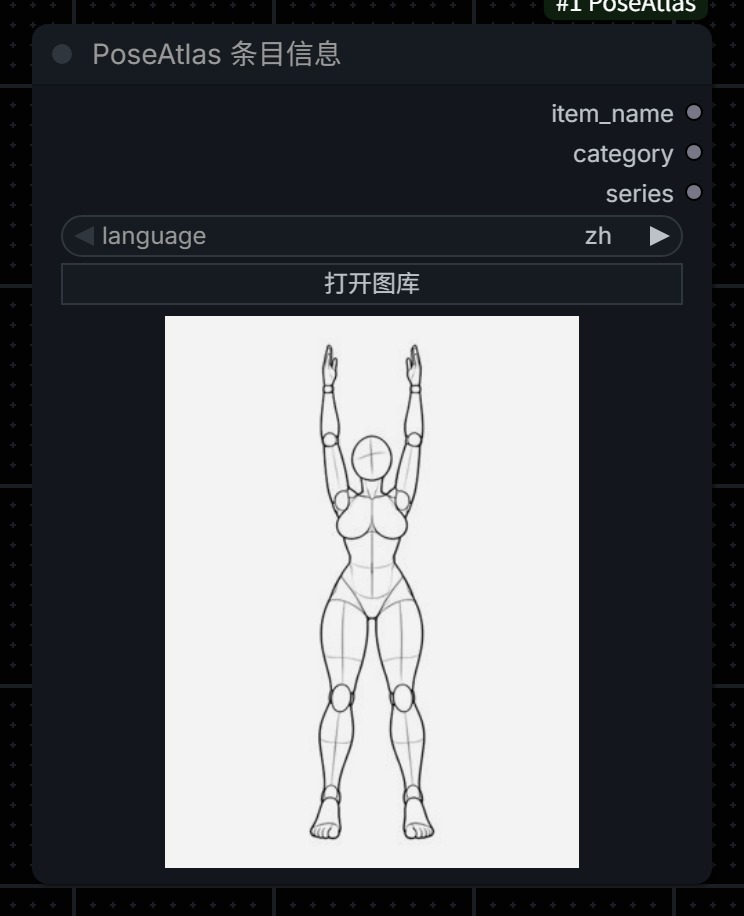

# ComfyUI-PoseAtlas

[中文](README.md) ｜ **English** ｜ [日本語](README.ja.md)

A ComfyUI node wrapping the **three galleries** of
[RuiC-PoseAtlas](https://github.com/HRuiCcc/RuiC-PoseAtlas):

| Gallery | Items | Spec | Contents |
|---|---|---|---|
| **Poses** | 1,439 | 900×1200 PNG | 288 poses × 5 angles (front / three-quarter / side / high / low), in two renders |
| **Costumes** | 1,407 | 1366×2048 WEBP | Organised by season × category × colour, 8 seasons × 10 categories |
| **Portraits** | 1,499 | full-size PNG | 893 faces + 606 styling shots, sorted into 4 hair-length buckets |

**4,345 items** in total. Pick one in the gallery and the node outputs `IMAGE`
directly — ready for ControlNet, img2img or an edit model.

> ⚠️ **This repository ships no images at all** — not even thumbnails. Zero.
> Image rights belong to the original authors, so after installing you must run
> the download script (step 3 under "Install"): 4,345 thumbnails, about 59 MB.



<details><summary>Costume / portrait / depth galleries</summary>







</details>

<details><summary>中文 / 日本語 interface</summary>





</details>

---

## What this is

RuiC-PoseAtlas is a static reference library. This project moves its browsing
experience into ComfyUI: no switching to a browser, no hunting for files, no
remembering 4,345 filenames — and one search box that matches Chinese, English
and Japanese.

**The pose gallery** gives each pose 5 viewpoints of a faceless grey mannequin,
made for reading volumes, proportions, joints and lens relationships. The same
1,439 variants (ids match one-to-one) also come as **grayscale depth renders**
where white is closer to the camera. Line art is good for skeleton extraction,
depth maps are good for ControlNet depth — and for couple poses the front/back
layering is visible in depth, which line art cannot show.

**v2.0 adds the costume and portrait galleries**: costumes are full-outfit
1366×2048 WEBPs (references for outfit swaps and clothing-style transfer),
portraits are clean face and styling shots without background clutter (character
consistency, hair references). All three galleries share one panel, one search
box and one set of trilingual names.

| Gallery | Render | Source | Good for |
|---|---|---|---|
| Poses | Line art | [POSE-DB-01](https://ai-pose-gallery.pages.dev/) | Skeleton extraction, img2img, edit models |
| Poses | Depth | [POSE-DB-02](https://ai-pose-depth-gallery.pages.dev/) | ControlNet depth, compositing that needs layering |
| Costumes | Original | RuiC-PoseAtlas | Outfit swaps, clothing style, styling references |
| Portraits | Original | RuiC-PoseAtlas | Character consistency, hair / makeup references |

## Trilingual interface (中文 / EN / 日本語)

The panel header has a language switch; one click flips the whole interface:

| Where | What switches |
|---|---|
| UI strings | Title, search box, sidebar heading, buttons, notices — three sets |
| Item names | Pose name, category, angle; costume season / category / colour; portrait section / hair / styling |
| Search | All three languages match the same entry |

**These translations are not ours.** Upstream RuiC-PoseAtlas already ships all
three names (`poses.json` carries `names.zh / .en / .ja` for every pose). This
project only reshapes them into the `labels` field of `index.json`; not a single
string was translated here. (Costume tag words and portrait styling names are
keys upstream — their three-language tables live in `scripts/_i18n/` and
`build_index.py` folds them in.)

The choice is stored in browser `localStorage` (key `poseatlas-node-lang`), so the
panel reopens in whatever language you last used.

> **The value stored in the dropdown is always the Chinese string** (e.g.
> `[性感全身] 站姿 / P001 ... / 正面`). That way one workflow opens correctly under
> any interface language — switching language only changes display, never a saved
> parameter.

## The two nodes

### PoseAtlas Gallery (`PoseAtlasLoader`)

| | |
|---|---|
| Inputs | `collection` (poses / costumes / portraits), `pose` (gallery choice), `render` (line art / depth), `invert_mask` |
| Outputs | `image` `IMAGE` · `mask` `MASK` · `item_name` `STRING` |

`collection`, `pose` and `render` are internal UI state owned by the panel; the
node only exposes `invert_mask` and "Open gallery". They are kept as widgets
because the Python side reads them to decide which files to load — drop them and
the node no longer knows which set you want.



In depth mode the node itself draws the depth thumbnail, so couple poses reveal
their front/back layering at a glance:



Clicking "Open gallery" gives a full-screen panel:

- **Collection tabs**: poses 1,439 / costumes 1,407 / portraits 1,499 — switching swaps the whole dataset
- **Language switch**: `中文 / EN / 日本語`
- **Render switch**: `线稿 / 深度` (pose gallery only; greyed out for the others)
- **Horizontal tabs**: poses by 4 series (sexy full-body 80 / standard full-body 73 / upper body 80 / couple 55) × 26 sub-categories; costumes by 8 seasons; portraits by face / styling
- **Left sidebar**: switches with the tab above, counts recomputed live for the current tab
- **Thumbnail grid**: for poses, all 5 angles of one pose collapse into a single card with in-card angle chips
- **Download button**: in depth mode every card carries `↓ 原图`, which fetches that angle's 900×1200 original
- **Search box**: Chinese / English / Japanese names, ids and categories, spanning all galleries
- **Footer**: id, name, category and file path of the current selection

### PoseAtlas Info (`PoseAtlasInfo`)

For text only, no image. Feed it `collection` + `pose` + `language` (zh / en / ja)
and it outputs `item_name` / `category` / `series` for prompt assembly.



---

## Install

### 1. Get the node

```bash
cd ComfyUI/custom_nodes
git clone https://github.com/mugicha-AI/ComfyUI-PoseAtlas.git
```

No git? Use `Code → Download ZIP` on GitHub and unzip into
`ComfyUI/custom_nodes/ComfyUI-PoseAtlas`.

### 2. Check the layout

Right after install it looks like this — **every image folder is empty** (only a
`.gitkeep` placeholder):

```
ComfyUI/custom_nodes/ComfyUI-PoseAtlas/
├── __init__.py
├── scripts/
│   ├── download_images.py      image downloader
│   ├── build_index.py          index rebuild (only if you edit the metadata)
│   └── _i18n/                  trilingual tables for costume tags / styling names
└── web/
    ├── poseatlas.js            gallery panel front-end
    └── atlas/
        ├── poses.json          metadata for 288 poses
        ├── costumes.json       metadata for 1,407 costumes
        ├── faces.json          metadata for 1,499 portraits
        ├── index.json          front-end index (4,345 entries, trilingual labels)
        ├── img/                ← empty, pose line-art originals
        ├── thumbs/             ← empty, pose line-art thumbnails
        ├── costume/{img,thumbs}   ← empty
        ├── portrait/{img,thumbs}  ← empty
        └── depth/{img,thumbs}     ← empty
```

### 3. Download the images (required, otherwise the gallery is empty)

Image rights belong to **ギア (@giaaibusi)** and the other original authors. This
project **does not bundle or redistribute** them; the script fetches them from the
public sources:

```bash
cd ComfyUI/custom_nodes/ComfyUI-PoseAtlas
python scripts/download_images.py                # thumbnails only, ≈59 MB (start here)
python scripts/download_images.py --full         # plus full-size originals, ≈5.4 GB
```

| Command | What you get | Size |
|---|---|---|
| `python scripts/download_images.py` | 4,345 thumbnails (poses / costumes / portraits) | ≈59 MB |
| `python scripts/download_images.py --full` | the above + pose line art, costume and portrait originals | ≈5.4 GB |
| `python scripts/download_images.py --only costume` | one gallery only (`pose` / `costume` / `portrait`) | — |
| `python scripts/download_images.py --dry-run` | report what is missing, download nothing | — |
| `python scripts/download_images.py --workers 12` | concurrency (default 8) | — |

- Every set cycles through several mirrors automatically (`raw.githubusercontent` → `jsdelivr` → `ghfast` → `gh-proxy`); a timeout moves to the next one
- Interrupted? Just re-run — existing files are skipped, so it resumes
- Magic bytes are checked before writing, so an error page never lands as a fake image
- Want just a part? `--only pose` is fastest (22 MB of thumbnails)

### 4. Depth originals (on demand, never in bulk)

The depth set is the **exception**. The source site states:

> 「このデータベースの画像を一括でダウンロードすること（ツール等による自動取得を含む）と、
> 取得した画像の再配布・転載・販売は禁止です」
> (Bulk downloading — including automated fetching by tools — and redistribution,
> reposting or resale of the obtained images are forbidden.)

So the download script **does not fetch depth originals** and deliberately offers
no bulk option. Instead, switch the panel to `深度` and click the **`↓ 原图`**
button on a card: the server fetches **that one** 900×1200 original from the source
site into `web/atlas/depth/img/`, and immediately derives a 300×400 thumbnail into
`depth/thumbs/`. From then on it uses the local file.

Fetching one you actually need is "reference an image while generating"; bulk
scraping is not. Please only click the ones you really use.

> Depth thumbnails are produced when you download an original — they are not
> shipped. On a new machine, or to rebuild them, run
> `python scripts/download_images.py --only depth-thumbs` to re-derive thumbnails
> for every depth original you already have locally (no network).

### 5. Restart ComfyUI

The node appears under the **`PoseAtlas`** category in the right-click menu, or
search `PoseAtlas` by double-clicking the canvas.

> **After editing anything under `web/`, force-reload with Ctrl+F5** or the
> browser keeps using the old front-end.

---

## Usage

### Simplest: just output an image

Drop a **PoseAtlas Gallery** node, click "Open gallery", pick one, and wire
`image` into anything that accepts `IMAGE`.

### With ControlNet (recommended)

Mannequin line art → skeleton → ControlNet → image. These settings are verified
on my machine:

```
PoseAtlas Gallery (collection=poses, render=line art)
   └─ image → PoseAndFaceDetection → DrawViTPose → ControlNetApplyAdvanced
                                                    ├─ control_net: xinsir_cn_union_sdxl_1.0_promax
                                                    ├─ strength: 0.65
                                                    └─ end_percent: 0.85
                                                       └─ KSampler → VAEDecode → SaveImage
```

**Key settings**:

| Setting | Value | Why |
|---|---|---|
| `PoseAndFaceDetection` width/height | **must match the output aspect ratio** | Feed a 3:4 image but enter 832×480 and the legs get cut off |
| ControlNet strength | `0.65` | 0.9 gives you a line-art look; too low loses the pose |
| end_percent | `0.85` | Lets the model own texture in later steps |
| Negative prompt | add `stick figure, sketch, lineart` | Stops it drawing over the skeleton |

The skeleton node comes from
[ComfyUI-WanAnimatePreprocess](https://github.com/kijai/ComfyUI-WanAnimatePreprocess)
(it bundles the ViTPose ONNX, so no extra controlnet_aux install). Without it, you
can also feed `image` straight into img2img or an edit model as a reference.

### Depth maps for ControlNet depth

Switch the render to `深度` in the panel and wire `image` directly into the depth
ControlNet's image input — no depth preprocessor needed, the image already is a
depth map. White is near, dark grey is far, matching the usual depth-ControlNet
convention.

Couple poses are better served by depth: ViTPose only detects one person in line
art, while the depth map preserves both figures' front/back relationship, so
feeding it to depth ControlNet or using it for a depth-of-field composite loses
nobody.

### Outfit swaps with the costume gallery

Costume entries are full-outfit images — wire them into an edit model's reference
input (Qwen-Image / Flux Kontext / Krea2):

```
PoseAtlas Gallery (collection=costumes) → image → TextEncodeQwenImage21 images.image_2
PoseAtlas Gallery (collection=poses)    → image → TextEncodeQwenImage21 images.image_1   ← pose
```

Write the prompt as "dress the person in `<image1>` with the outfit from
`<image2>`, keeping `<image1>`'s pose and body proportions". Costume images come
with a model wearing them; when what you want is **the clothes, not the person**,
say so explicitly: "take only the garment style and colours; identity comes from
`<image1>`".

### Character consistency with the portrait gallery

Portraits are clean face and styling shots, good as face references:

```
PoseAtlas Gallery (collection=portraits, section=face) → image → reference input
```

Combined with the pose gallery, hand `image_1` the pose and `image_2` the face and
identify each in the prompt.
**Note**: the mannequin's waist-to-chest ratio is exaggerated and the resulting
person tends to look bulky — add "use normal human proportions" to the prompt.

### Example workflows

`examples/` holds 8 workflows; drag them in, or use `Workflow → Open`. The matching
`.png` is a full-canvas screenshot of each workflow, so you can preview before
loading.

| File | Galleries used | Chain | Base model |
|---|---|---|---|
| `basic_loader.json` | poses | Gallery → SaveImage (minimal) | none |
| `Flux3Klein-PoseAtlas.json` | poses | Gallery + reference → prompt rewrite → generate → side-by-side | Flux3 Klein |
| `QW2.1-PoseAtlas.json` | poses | Gallery + reference → prompt rewrite → edit → side-by-side | Qwen-Image 2.1 |
| `Flux3Klein-换装-PoseAtlas.json` | costumes | Costume + person reference → outfit swap | Flux3 Klein |
| `QW2.1-换装-PoseAtlas.json` | costumes | Costume + person reference → outfit swap | Qwen-Image 2.1 |
| `QW2.1-PoseAtlas-Assembly.json` | poses + costumes + portraits | **three galleries together**: pose / outfit / face → composite | Qwen-Image 2.1 |
| `Mugicha_Krea2_depth.json` | poses (depth) | Depth map → Krea2 ControlNet → image | Krea2 |
| `Mugicha_MossImage_depth.json` | poses (depth) | Depth map → MossImage Control → image | MossImage |

Caveats:

- They rely on common custom nodes (`rgthree-comfy`, `comfyui-easy-use`, `ComfyUI-WanAnimatePreprocess`, …); ComfyUI flags anything missing in red
- Model filenames in the workflows are my local quantised names (e.g. `qwen_image_2.1_int8_convrot`) — swap in your own downloads
- The companion LoRAs differ: pose / composite workflows use `Qwen-Image-2.1-multiple_angles`
  (helps multi-angle following), outfit swaps use `Qwen-Image-2.1-outfit-swap`, and the depth
  workflows use their own depth-control LoRAs. Drop the node if you don't have one

---

## No local GPU?

The node itself is light (it only reads images), but the accompanying ControlNet
and edit models need VRAM. If you have no machine that can run ComfyUI, try a
cloud one:

| Platform | Notes |
|---|---|
| [RunningHub](https://www.runninghub.ai/?inviteCode=rh-v1603) | Cloud ComfyUI, run workflows online, no local setup |
| [ZZAI 真真AI](https://www.zzai.app/?aff=bFpY) | All-in-one AI creation platform, canvas agent builds flows from one sentence, OpenAI-compatible API |

> Those links carry invite codes; signing up through them earns me a small
> referral fee and does not change your cost. Visiting the sites directly works
> the same.

---

## Known limitations

| Limitation | Cause | Workaround |
|---|---|---|
| **Not a single image in the repo** | Rights belong to the original author; no redistribution | Run `python scripts/download_images.py` after installing (≈59 MB) |
| **Skeleton extraction finds only one person in couple poses (55 groups)** | ViTPose is single-person | Use the depth map with depth ControlNet, or feed `image` to an edit model |
| Depth originals must be clicked one by one | The source site forbids bulk fetching | Download only what you need; no bulk script exists on purpose |
| Depth thumbnails need the original first | Thumbnails are derived from the original | Clicking `↓ 原图` generates the thumbnail too |
| Mannequin images have no alpha | Originals are RGB PNG | `mask` outputs all ones; only `invert_mask` applies |
| The gallery loads client-side | The front-end reads from `/extensions/` | ~1 s on first open, cached afterwards |
| Portrait originals are large | 1,499 PNGs, ≈4.6 GB | Skip `--full` to keep thumbnails only |
| Third-party translation extensions rewrite panel text | They substitute from a hard-coded dictionary | The panel is marked `.notranslate`; if a plugin ignores it, update `ComfyUI-DD-Translation` to honour that convention |

## Content notice

The original gallery's categories include adult-oriented material
("sexy / bold", "lingerie", "swimwear", "sexy" …) and target adult creators. Obey
your local laws and platform rules.

---

## Copyright and licensing

| Item | License |
|---|---|
| Project code (`__init__.py`, `web/poseatlas.js`, `scripts/*`) | **MIT** |
| Pose line art, depth maps, costume images, portraits, raw data, names (including the trilingual names) | **Copyright ギア (@giaaibusi)**, not covered by MIT |

The original author allows creative use (commercial, editing, reference) but
**forbids redistributing, reposting or reselling the image data itself**. That is
why this repo carries not a single image — only metadata, the index and the
download scripts. If you fork this project, please keep it that way.

- Original / line-art site: [POSE-DB-01](https://ai-pose-gallery.pages.dev/)
- Depth site: POSE-DB-02 <https://ai-pose-depth-gallery.pages.dev/>
- Original author: [ギア (@giaaibusi)](https://x.com/giaaibusi)
- Data preparation and front-end: [RuiC-PoseAtlas](https://github.com/HRuiCcc/RuiC-PoseAtlas) by [HRuiCcc](https://github.com/HRuiCcc)

This is an unofficial project with no affiliation to the original author or to
RuiC-PoseAtlas. If the original author believes this repository infringes their
rights, please open an [Issue](https://github.com/mugicha-AI/ComfyUI-PoseAtlas/issues)
and the content will be removed promptly.

---

## Credits

- Pose line art, depth maps and raw data: ギア (@giaaibusi)
- Data preparation, trilingual names, gallery front-end: HRuiCcc / RuiC-PoseAtlas
- Skeleton node: kijai / ComfyUI-WanAnimatePreprocess

## Video walkthrough

I have made a few videos covering this node — pick whichever platform you prefer:

| Platform | Link |
|---|---|
| Bilibili (Chinese) | [PoseAtlas 实测：1439 张多角度人台线稿，我把它做成了 ComfyUI 节点](https://www.bilibili.com/video/BV1CFxi6uEhk/) |
| YouTube | [PoseAtlas 实测：1439 张多角度人台线稿，我把它做成了 ComfyUI 节点](https://www.youtube.com/watch?v=3_gDBeM9o6U) |

```
PoseAtlas 实测：1439 张多角度人台线稿，我把它做成了 ComfyUI 节点
```
*(Title as published: "PoseAtlas hands-on — 1439 multi-angle mannequin references, turned into a ComfyUI node". The videos are in Chinese.)*

They walk through the gallery panel, the difference between line art and depth
maps, the exact ControlNet skeleton-extraction settings, and why couple poses are
better handled through depth. For the written version see "Usage" above.

## About the author

- GitHub: [@mugicha-AI](https://github.com/mugicha-AI)
- More ComfyUI workflows and write-ups will land here

If this node saved you time hunting reference images, a ⭐ Star is welcome.

## License

Code is MIT, see [LICENSE](LICENSE). Images are not covered.
