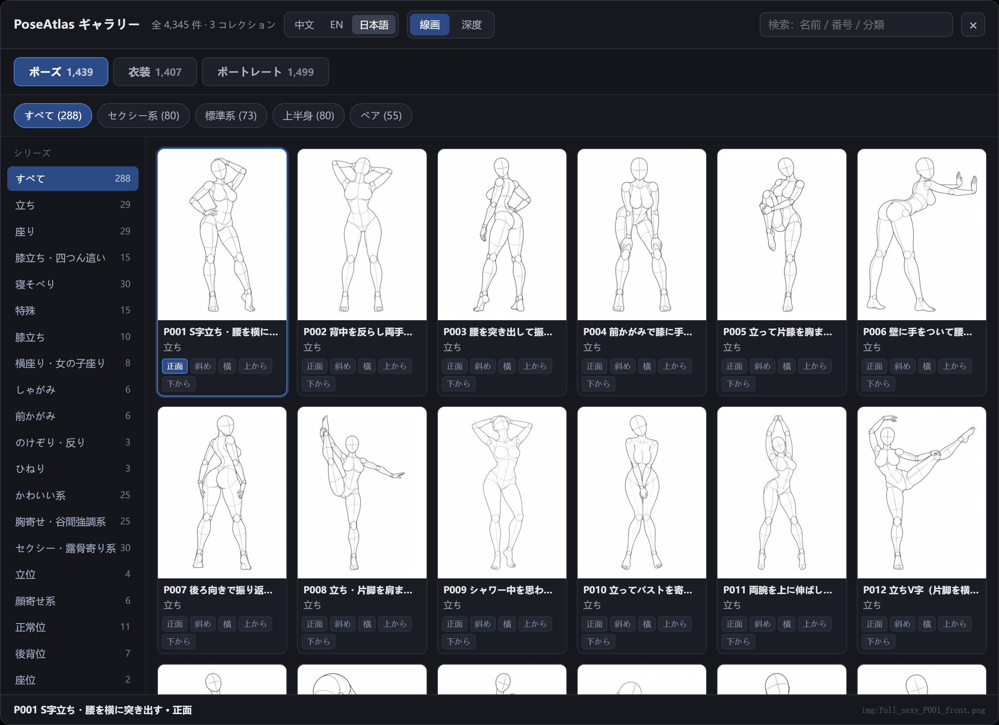
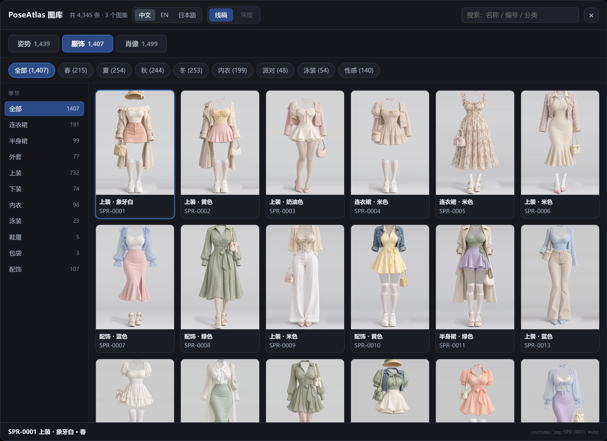
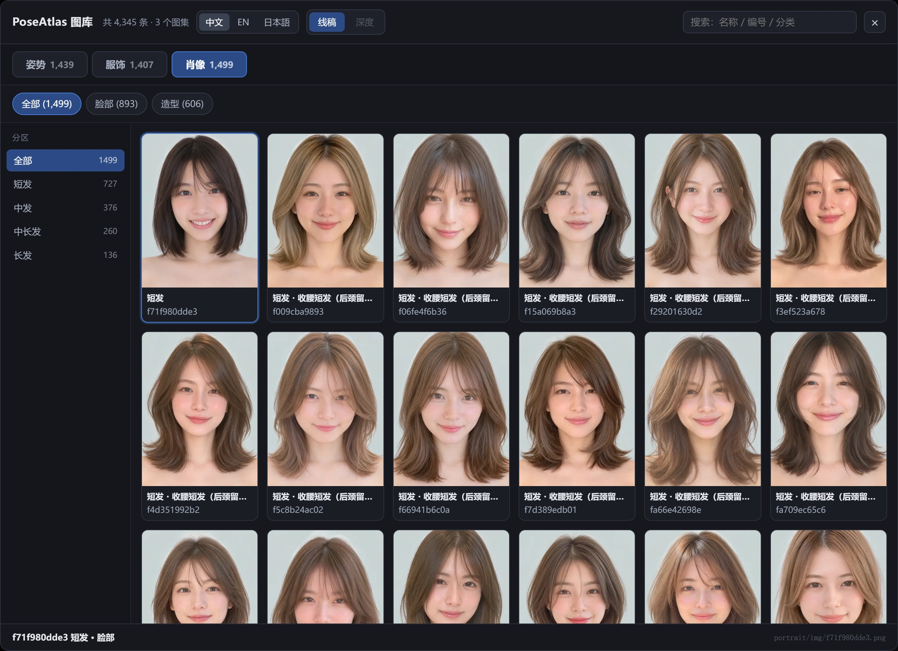
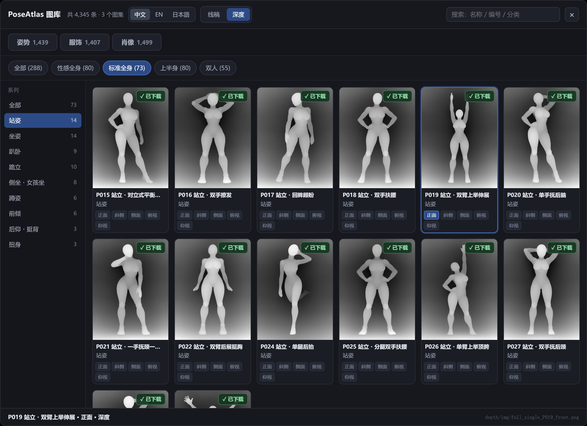
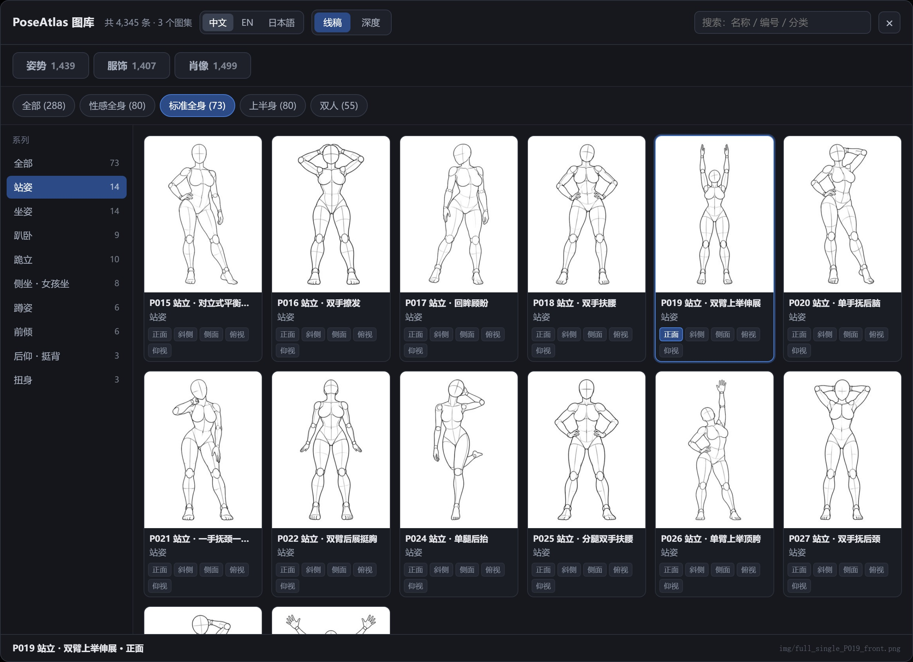
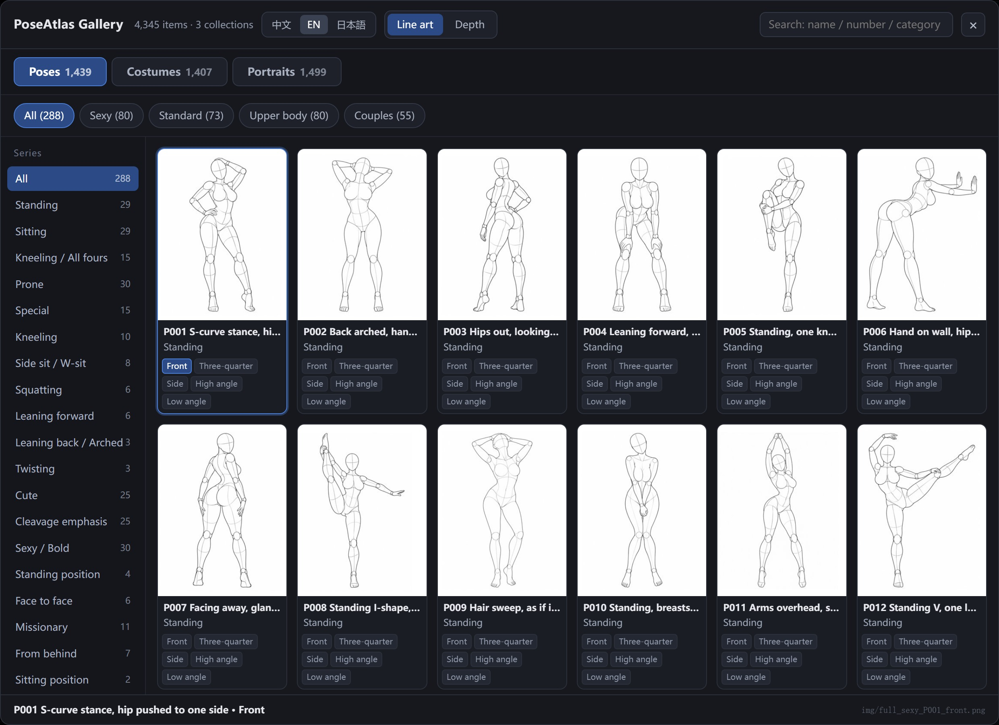
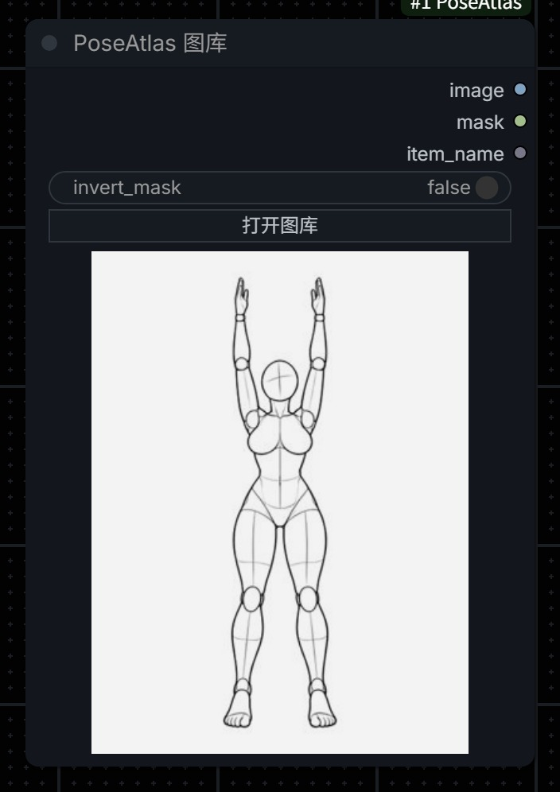
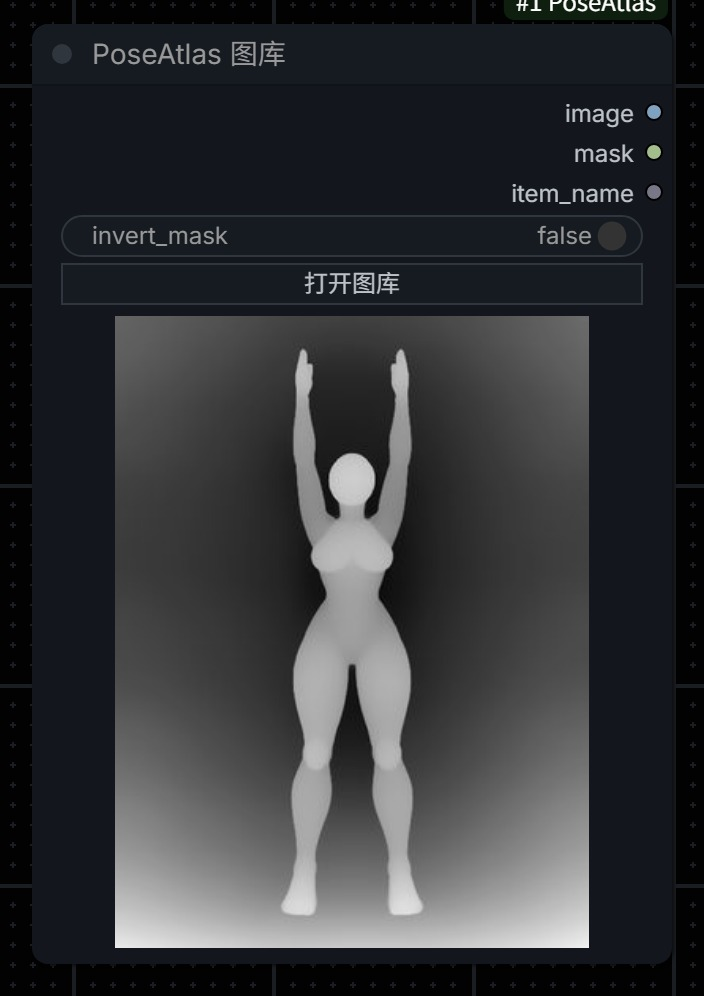
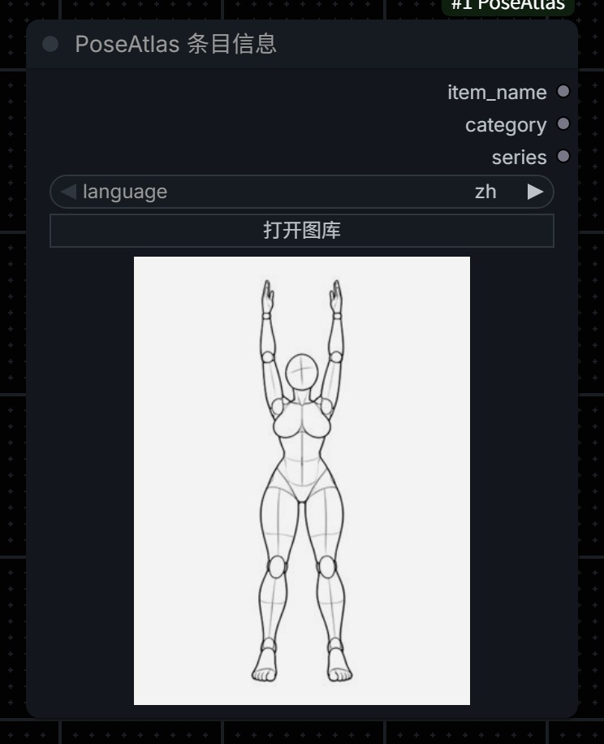

# ComfyUI-PoseAtlas

[中文](README.md) ｜ [English](README.en.md) ｜ **日本語**

[RuiC-PoseAtlas](https://github.com/HRuiCcc/RuiC-PoseAtlas) の**3 つのギャラリー**を
ComfyUI ノードにしたものです：

| ギャラリー | 件数 | 仕様 | 内容 |
|---|---|---|---|
| **ポーズ** | 1,439 | 900×1200 PNG | 288 ポーズ × 5 アングル（正面 / 斜め / 横 / 上から / 下から）、2 種類のレンダリング |
| **衣装** | 1,407 | 1366×2048 WEBP | 季節 × カテゴリ × 色で整理、8 季節 × 10 カテゴリ |
| **ポートレート** | 1,499 | 原寸 PNG | フェイス 893 + スタイリング 606、髪の長さ 4 段階で分類 |

合計 **4,345 件**。ギャラリーで 1 枚選べばそのまま `IMAGE` を出力でき、
ControlNet・img2img・編集モデルに繋げられます。

> ⚠️ **このリポジトリには画像が 1 枚も入っていません**。サムネイルも含めてゼロです。
> 画像の権利は原作者に帰属するため、インストール後に「インストール」の手順 3 の
> ダウンロードスクリプトを実行してください（4,345 枚のサムネイルで約 59 MB）。



<details><summary>衣装 / ポートレート / 深度ギャラリー</summary>







</details>

<details><summary>中文 / English インターフェース</summary>





</details>

---

## これは何か

RuiC-PoseAtlas は静的な参考画像ライブラリです。本プロジェクトはその閲覧体験を
ComfyUI に持ち込みます：ブラウザに切り替える必要も、ファイルを探す必要も、
4,345 個のファイル名を覚える必要もありません。検索欄は中国語・英語・日本語すべてに
ヒットします。

**ポーズ集**は 1 ポーズにつき 5 視点、顔のないグレーのマネキン線画で、ボリューム・比率・
関節・レンズ関係を読み取るためのものです。同じ 1,439 変体（id は 1 対 1 対応）には
**グレースケール深度レンダリング**もあり、白いほど手前を表します。線画は骨格抽出に、
深度は ControlNet depth に向いています。ペアのポーズでは前後の重なりが深度で層になり、
これは線画では得られません。

**v2.0 で衣装集とポートレート集を追加**：衣装は 1366×2048 の全身コーデ画像
（着せ替え・服装スタイル転送の参考）、ポートレートは背景の雑味がない顔とスタイリングの
画像（キャラクター一貫性・髪型の参考）です。3 つのギャラリーは 1 つのパネル、1 つの検索欄、
1 つの 3 言語名を共有します。

| ギャラリー | レンダリング | 出典 | 用途 |
|---|---|---|---|
| ポーズ | 線画 | [POSE-DB-01](https://ai-pose-gallery.pages.dev/) | 骨格抽出、img2img、編集モデル |
| ポーズ | 深度 | [POSE-DB-02](https://ai-pose-depth-gallery.pages.dev/) | ControlNet depth、前後関係が要る合成 |
| 衣装 | 原寸 | RuiC-PoseAtlas | 着せ替え、服装スタイル、コーデ参考 |
| ポートレート | 原寸 | RuiC-PoseAtlas | キャラクター一貫性、髪型 / メイク参考 |

## 3 言語インターフェース（中文 / EN / 日本語）

パネル右上の言語切り替えで、インターフェース全体が切り替わります：

| 場所 | 切り替わる内容 |
|---|---|
| UI 文言 | タイトル、検索欄、サイドバー見出し、ボタン、注意書きの 3 セット |
| 項目名 | ポーズ名・分類・アングル、衣装の季節 / カテゴリ / 色、ポートレートの部位 / 髪型 / スタイリング |
| 検索 | 3 言語のどの名前でも同じ項目にヒット |

**これらの翻訳は本プロジェクトのものではありません。** 上流の RuiC-PoseAtlas が
すでに `zh` / `en` / `ja` の 3 名称を持っており（`poses.json` の各ポーズに
`names.zh / .en / .ja`）、本プロジェクトはそれを `index.json` の `labels` に
そのまま移しただけです。翻訳は 1 文字も追加していません。
（衣装のタグ語とポートレートのスタイリング名は上流では key なので、3 言語表を
`scripts/_i18n/` に置き、`build_index.py` が合成します。）

選択はブラウザの `localStorage`（キー `poseatlas-node-lang`）に保存され、
次回も前回の言語で開きます。

> **ドロップダウンに保存される値は常に中国語の文字列**です（例：
> `[性感全身] 站姿 / P001 ... / 正面`）。こうすることで、同じワークフローがどの
> 表示言語でも正しく開けます。言語切り替えは表示だけに影響し、保存済みのパラメータは
> 変わりません。

## 2 つのノード

### PoseAtlas ギャラリー（`PoseAtlasLoader`）

| | |
|---|---|
| 入力 | `collection`（ポーズ / 衣装 / ポートレート）、`pose`（ギャラリー選択）、`render`（線画 / 深度）、`invert_mask` |
| 出力 | `image` `IMAGE` · `mask` `MASK` · `item_name` `STRING` |

`collection` / `pose` / `render` はパネルが管理する内部 UI 状態で、ノード上には
`invert_mask` と「ギャラリーを開く」だけを出しています。これらを残しているのは、
Python 側がこの値で読み込むファイル群を決めるためです。削るとノードはどれを使うか
分からなくなります。



深度モードではノード上に深度サムネイルが描画され、ペアポーズの前後関係が一目で分かります：



「ギャラリーを開く」で全画面パネルが開きます：

- **ギャラリータブ**：ポーズ 1,439 / 衣装 1,407 / ポートレート 1,499、切り替えるとデータ全体が入れ替わります
- **言語**：`中文 / EN / 日本語`
- **レンダリング**：`线稿 / 深度`（ポーズ集のみ有効、他はグレーアウト）
- **上部タブ**：ポーズは 4 シリーズ（セクシー系 80 / 標準系 73 / 上半身 80 / ペア 55）× 26 サブ分類、
  衣装は 8 季節、ポートレートは フェイス / スタイリング
- **左サイドバー**：上部タブに応じて動的に変化、件数は現在のタブで再計算
- **サムネイルグリッド**：ポーズは同じポーズの 5 アングルを 1 枚のカードにまとめ、カード内のタグで切り替え
- **ダウンロードボタン**：深度モードでは各カード右上の `↓ 原图` でそのアングルの 900×1200 原寸を取得
- **検索欄**：中国語 / 英語 / 日本語の名前、番号、分類で検索、ギャラリーをまたいでヒット
- **下部**：現在の選択の番号、名前、分類、ファイルパス

### PoseAtlas 項目情報（`PoseAtlasInfo`）

文字だけ欲しいとき用。`collection` + `pose` + `language`（zh / en / ja）を入力し、
`item_name` / `category` / `series` を出力します。プロンプトへの合成に便利です。



---

## インストール

### 1. ノードを取得

```bash
cd ComfyUI/custom_nodes
git clone https://github.com/mugicha-AI/ComfyUI-PoseAtlas.git
```

git がない場合は GitHub の `Code → Download ZIP` で
`ComfyUI/custom_nodes/ComfyUI-PoseAtlas` に展開してください。

### 2. ディレクトリを確認

クローン直後はこうなります——**画像フォルダはすべて空**です（`.gitkeep` の
プレースホルダのみ）：

```
ComfyUI/custom_nodes/ComfyUI-PoseAtlas/
├── __init__.py
├── scripts/
│   ├── download_images.py      画像ダウンローダー
│   ├── build_index.py          インデックス再生成（メタデータを変えたときだけ）
│   └── _i18n/                  衣装タグ / スタイリング名の 3 言語表
└── web/
    ├── poseatlas.js            ギャラリーパネルのフロントエンド
    └── atlas/
        ├── poses.json          288 ポーズのメタデータ
        ├── costumes.json       1,407 着のメタデータ
        ├── faces.json          1,499 枚のメタデータ
        ├── index.json          フロント用インデックス（4,345 件、3 言語ラベル）
        ├── img/                ← 空、ポーズ線画の原寸
        ├── thumbs/             ← 空、ポーズ線画のサムネイル
        ├── costume/{img,thumbs}   ← 空
        ├── portrait/{img,thumbs}  ← 空
        └── depth/{img,thumbs}     ← 空
```

### 3. 画像をダウンロード（必須、やらないとギャラリーが空です）

画像の権利は **ギア (@giaaibusi)** ほか原作者に帰属します。本プロジェクトは
**同梱も再配布もせず**、公開出典から取得するスクリプトだけを提供します：

```bash
cd ComfyUI/custom_nodes/ComfyUI-PoseAtlas
python scripts/download_images.py                # サムネイルのみ、約 59 MB（まずこれ）
python scripts/download_images.py --full         # 原寸も含む、約 5.4 GB
```

| コマンド | 取得内容 | サイズ |
|---|---|---|
| `python scripts/download_images.py` | 4,345 枚のサムネイル（ポーズ / 衣装 / ポートレート） | 約 59 MB |
| `python scripts/download_images.py --full` | 上記 + ポーズ線画・衣装・ポートレートの原寸 | 約 5.4 GB |
| `python scripts/download_images.py --only costume` | 1 セットだけ（`pose` / `costume` / `portrait`） | — |
| `python scripts/download_images.py --dry-run` | 不足分の集計のみ、ダウンロードしない | — |
| `python scripts/download_images.py --workers 12` | 並列数（既定 8） | — |

- 各セットは複数ミラーを自動で切り替えます（`raw.githubusercontent` → `jsdelivr` → `ghfast` → `gh-proxy`）、タイムアウトしたら次へ
- 中断しても再実行すれば既存ファイルはスキップされ、続きから再開します
- 書き込み前にマジックバイトを検証するので、エラーページが偽画像として保存されることはありません
- 一部だけ欲しい場合：`--only pose` が最速です（サムネイル 22 MB）

### 4. 深度原寸（オンデマンド、一括取得はしません）

深度セットだけは**例外**です。出典サイトには次のように明記されています：

> 「このデータベースの画像を一括でダウンロードすること（ツール等による自動取得を含む）と、
> 取得した画像の再配布・転載・販売は禁止です」

そのためダウンロードスクリプトは**深度原寸を取得せず**、一括取得の手段も提供しません。
代わりにパネルを「深度」に切り替え、カード右上の **`↓ 原图`** を押します。サーバ側が
**その 1 枚**の 900×1200 原寸を出典サイトから `web/atlas/depth/img/` に取得し、
同時に 300×400 のサムネイルを `depth/thumbs/` に生成します。以後はローカルを使います。

本当に使う 1 枚を取得するのは「生成時の参考」という使い方ですが、一括取得はそうでは
ありません。実際に使う数枚だけをクリックしてください。

> 深度サムネイルは原寸を取得したときに生成されるもので、同梱はしていません。
> 別マシンに移した場合やサムネイルを作り直したい場合は
> `python scripts/download_images.py --only depth-thumbs` で、**ローカルに既にある**
> 深度原寸からすべて縮小し直せます（ネットワーク不要）。

### 5. ComfyUI を再起動

右クリックメニューの **`PoseAtlas`** カテゴリに出ます。キャンバスをダブルクリックして
`PoseAtlas` で検索しても出ます。

> **`web/` 配下を編集したら Ctrl+F5 で強制リロード**してください。
> そうしないとブラウザは古いフロントエンドを使い続けます。

---

## 使い方

### 最小構成：そのまま出力

**PoseAtlas ギャラリー** ノードを置き、「ギャラリーを開く」で 1 枚選び、`image` を
`IMAGE` を受け取るノードに繋ぐだけです。

### ControlNet と組み合わせる（推奨）

マネキン線画 → 骨格抽出 → ControlNet → 出力。手元で実測した設定です：

```
PoseAtlas ギャラリー（collection=ポーズ, render=線画）
   └─ image → PoseAndFaceDetection → DrawViTPose → ControlNetApplyAdvanced
                                                     ├─ control_net: xinsir_cn_union_sdxl_1.0_promax
                                                     ├─ strength: 0.65
                                                     └─ end_percent: 0.85
                                                        └─ KSampler → VAEDecode → SaveImage
```

**重要な設定**：

| 設定 | 値 | 理由 |
|---|---|---|
| `PoseAndFaceDetection` の width/height | **出力のアスペクト比と一致させる** | 3:4 の画像に 832×480 を入れると脚が切れます |
| ControlNet strength | `0.65` | 0.9 だと線画風になり、低すぎるとポーズが抜けます |
| end_percent | `0.85` | 後半はモデルに質感を任せます |
| ネガティブ | `stick figure, sketch, lineart` を追加 | 骨格の上に線を描くのを防ぎます |

骨格抽出ノードは
[ComfyUI-WanAnimatePreprocess](https://github.com/kijai/ComfyUI-WanAnimatePreprocess)
のものです（ViTPose ONNX を同梱、controlnet_aux の追加インストール不要）。
これがない場合でも、`image` をそのまま img2img や編集モデルの参考画像として
渡せます。

### 深度マップで ControlNet depth

パネルでレンダリングを「深度」に切り替え、`image` を深度 ControlNet の image 入力へ
直接繋ぎます（深度プリプロセッサは不要、画像自体が深度マップです）。白が手前、
濃いグレーが奥で、一般的な深度 ControlNet の約束と同じです。

ペアポーズは深度版が有利です：線画では ViTPose が 1 人しか検出しませんが、深度マップは
2 人の前後関係を保つので、depth ControlNet に渡しても被写界深度合成に使っても人物が
欠けません。

### 衣装集で着せ替え

衣装は全身コーデの画像なので、編集モデル（Qwen-Image / Flux Kontext / Krea2）の
参考画像入力に繋ぎます：

```
PoseAtlas ギャラリー（collection=衣装） → image → TextEncodeQwenImage21 の images.image_2
PoseAtlas ギャラリー（collection=ポーズ） → image → TextEncodeQwenImage21 の images.image_1   ← ポーズ
```

プロンプトには「`<image1>` の人物に `<image2>` の服を着せ、`<image1>` のポーズと
体型は保つ」と書きます。衣装画像にはモデルが着ています。**欲しいのが服で人ではない**
場合は、「服のデザインと配色だけを取り、人物の同一性は `<image1>` に従う」と明記して
ください。

### ポートレート集でキャラクター一貫性

ポートレートは背景の雑味がない顔・スタイリング画像なので、顔の参考に向いています：

```
PoseAtlas ギャラリー（collection=ポートレート, section=フェイス） → image → 参考画像入力
```

ポーズ集と組み合わせる場合は `image_1` にポーズ、`image_2` に顔を渡し、プロンプトで
それぞれを指し示します。
**注意**：マネキン自体の胸腰比が誇張されているため、実在人物はたくましく出がちです。
プロンプトに「正常な人体比率にする」と補ってください。

### サンプルワークフロー

`examples/` に 8 つのワークフローがあります。ドラッグするか、メニューの
`ワークフロー → 開く` から読み込んでください。同名の `.png` はワークフロー全体の
スクリーンショットなので、読み込む前に出来上がりを確認できます：

| ファイル | 使うギャラリー | 構成 | ベースモデル |
|---|---|---|---|
| `basic_loader.json` | ポーズ | ギャラリー → SaveImage（最小構成） | なし |
| `Flux3Klein-PoseAtlas.json` | ポーズ | ギャラリー + 参考画像 → プロンプト書き換え → 生成 → 比較出力 | Flux3 Klein |
| `QW2.1-PoseAtlas.json` | ポーズ | ギャラリー + 参考画像 → プロンプト書き換え → 編集 → 比較出力 | Qwen-Image 2.1 |
| `Flux3Klein-换装-PoseAtlas.json` | 衣装 | 衣装 + 人物参考 → 着せ替え出力 | Flux3 Klein |
| `QW2.1-换装-PoseAtlas.json` | 衣装 | 衣装 + 人物参考 → 着せ替え出力 | Qwen-Image 2.1 |
| `QW2.1-PoseAtlas-Assembly.json` | ポーズ + 衣装 + ポートレート | **3 ギャラリー連携**：ポーズ / 服 / 顔を 1 枚ずつ → 合成 | Qwen-Image 2.1 |
| `Mugicha_Krea2_depth.json` | ポーズ（深度） | 深度マップ → Krea2 ControlNet → 出力 | Krea2 |
| `Mugicha_MossImage_depth.json` | ポーズ（深度） | 深度マップ → MossImage Control → 出力 | MossImage |

注意点：

- `rgthree-comfy`、`comfyui-easy-use`、`ComfyUI-WanAnimatePreprocess` などの一般的なカスタムノードに依存します。不足は ComfyUI が赤枠で知らせます
- ワークフロー内のモデルファイル名は手元の量子化版の名前です（例 `qwen_image_2.1_int8_convrot`）。インポート後に自分でダウンロードしたモデルへ置き換えてください
- 併用する LoRA は種類ごとに異なります：ポーズ / 合成は `Qwen-Image-2.1-multiple_angles`
  （多アングル追従の強化）、着せ替えは `Qwen-Image-2.1-outfit-swap`、深度は各 depth-control LoRA。
  持っていなければそのノードを外してください

---

## ローカル GPU がない場合

このノード自体は軽量です（画像を読むだけ）が、組み合わせる ControlNet や編集モデルは
VRAM を必要とします。ComfyUI を動かせるマシンがない場合はクラウドの ComfyUI が使えます：

| プラットフォーム | 特徴 |
|---|---|
| [RunningHub](https://www.runninghub.ai/?inviteCode=rh-v1603) | クラウド ComfyUI、オンラインでワークフローを実行、環境構築不要 |
| [ZZAI 真真AI](https://www.zzai.app/?aff=bFpY) | オールインワン AI 制作プラットフォーム、キャンバスエージェントが一言でフローを構築、OpenAI 互換 API |

> 上記リンクには招待コードが含まれます。そこから登録すると私に少額の紹介料が入りますが、
> あなたの利用コストは変わりません。リンクを使わず直接アクセスしても同じように使えます。

---

## 既知の制限

| 制限 | 原因 | 対処 |
|---|---|---|
| **リポジトリに画像が 1 枚もない** | 権利が原作者にあり、再配布しない | インストール後に `python scripts/download_images.py`（約 59 MB） |
| **ペアポーズ（55 組）の骨格抽出が 1 人しか検出しない** | ViTPose が単人物向け | 深度マップで depth ControlNet、または `image` を編集モデルに渡す |
| 深度原寸は 1 枚ずつクリック | 出典サイトが一括取得を禁止 | 本当に使う分だけ取得。一括スクリプトを置かないのは意図的 |
| 深度サムネイルには原寸が必要 | サムネイルは原寸から生成 | `↓ 原图` を押すとサムネイルも同時に生成されます |
| マネキン画像にアルファがない | 原寸が RGB PNG | `mask` は全て 1、`invert_mask` のみ有効 |
| ギャラリーはブラウザ側で読み込む | フロントが `/extensions/` から読む | 初回は約 1 秒、以後はキャッシュ |
| ポートレートの原寸が大きい | 1,499 枚の PNG で約 4.6 GB | 容量が厳しければ `--full` を付けずサムネイルのみ |
| サードパーティの翻訳拡張がパネル文言を書き換える | ハードコード辞書で置換するため | パネルは `.notranslate` 指定済み。対応しない場合は `ComfyUI-DD-Translation` を更新して規約に従わせてください |

## コンテンツについて

原ギャラリーの分類には成人向けの内容（「セクシー・大胆系」「ランジェリー」「水着」
「セクシー」など）が含まれ、成人の制作者向けです。お住まいの法令とプラットフォームの
規約に従ってください。

---

## 著作権とライセンス

| 対象 | ライセンス |
|---|---|
| 本プロジェクトのコード（`__init__.py`、`web/poseatlas.js`、`scripts/*`） | **MIT** |
| ポーズ線画、深度マップ、衣装画像、ポートレート、元データ、名称（3 言語名を含む） | **著作権はギア (@giaaibusi) に帰属**、MIT の対象外 |

原作者は作品の創作利用（商用・編集・参考を含む）を認めていますが、**画像データ自体の
再配布・転載・転売は禁止**しています。そのため本リポジトリは画像を 1 枚も持たず、
メタデータ・インデックス・ダウンロードスクリプトだけを置いています。
フォークする場合も同じ方針を保ってください。

- 原作 / 線画サイト：[POSE-DB-01](https://ai-pose-gallery.pages.dev/)
- 深度サイト：POSE-DB-02 <https://ai-pose-depth-gallery.pages.dev/>
- 原作者：[ギア (@giaaibusi)](https://x.com/giaaibusi)
- データ整理とフロントエンド：[RuiC-PoseAtlas](https://github.com/HRuiCcc/RuiC-PoseAtlas) by [HRuiCcc](https://github.com/HRuiCcc)

本プロジェクトは非公式のまとめであり、原作者および RuiC-PoseAtlas の作者とは
一切関係がありません。原作者が権利侵害と判断した場合は
[Issue](https://github.com/mugicha-AI/ComfyUI-PoseAtlas/issues) でご連絡ください。
速やかに削除します。

---

## 謝辞

- ポーズ線画、深度マップ、元データ：ギア (@giaaibusi)
- データ整理、3 言語名、ギャラリーのフロントエンド：HRuiCcc / RuiC-PoseAtlas
- 骨格抽出ノード：kijai / ComfyUI-WanAnimatePreprocess

## 動画での解説

このノードの使い方を何本か動画にしています。お好みのプラットフォームでどうぞ：

| プラットフォーム | リンク |
|---|---|
| Bilibili（中国語） | [PoseAtlas 実測：1,439 枚の多アングルマネキン線画を ComfyUI ノードにしました](https://www.bilibili.com/video/BV1CFxi6uEhk/) |
| YouTube | [PoseAtlas 実測：1,439 枚の多アングルマネキン線画を ComfyUI ノードにしました](https://www.youtube.com/watch?v=3_gDBeM9o6U) |

```
PoseAtlas 実測：1439 张多角度人台线稿，我把它做成了 ComfyUI 节点
```
*（公開時のタイトル。動画は中国語です。）*

内容：ギャラリーパネルの使い方、線画と深度の違い、ControlNet で骨格抽出する実際の
設定、ペアポーズで深度を勧める理由。テキスト版は上の「使い方」にあります。

## 作者について

- GitHub：[@mugicha-AI](https://github.com/mugicha-AI)
- ComfyUI のワークフローと解説を今後もここに公開していきます

参考画像を探す時間が減ったなら、⭐ Star をいただけると嬉しいです。

## License

コードは MIT、[LICENSE](LICENSE) を参照。画像は対象外です。
