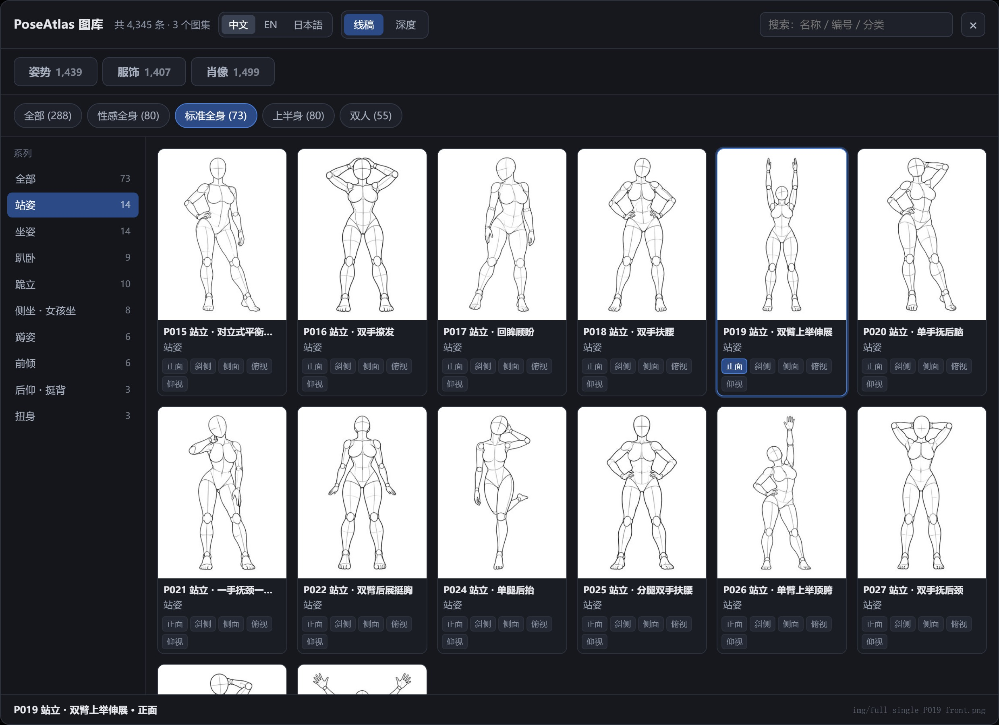
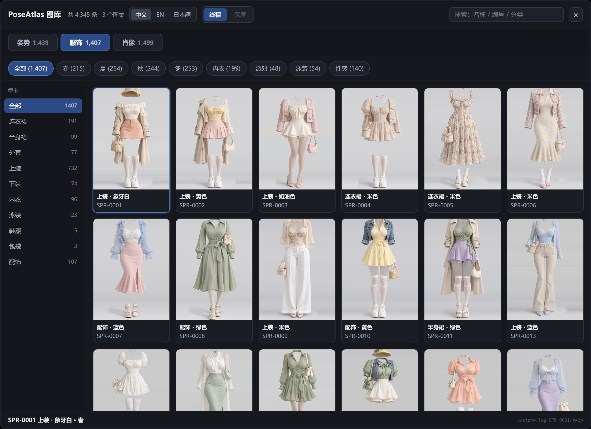
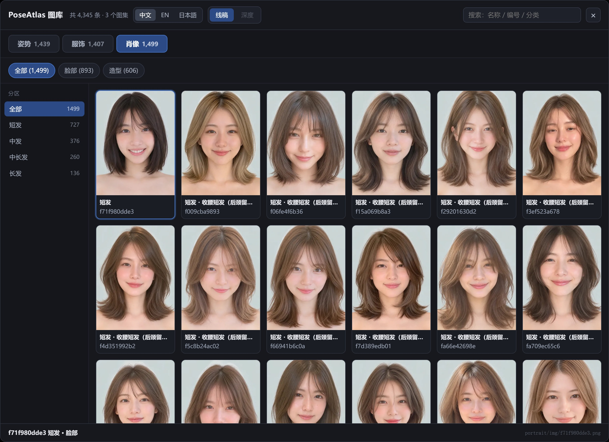
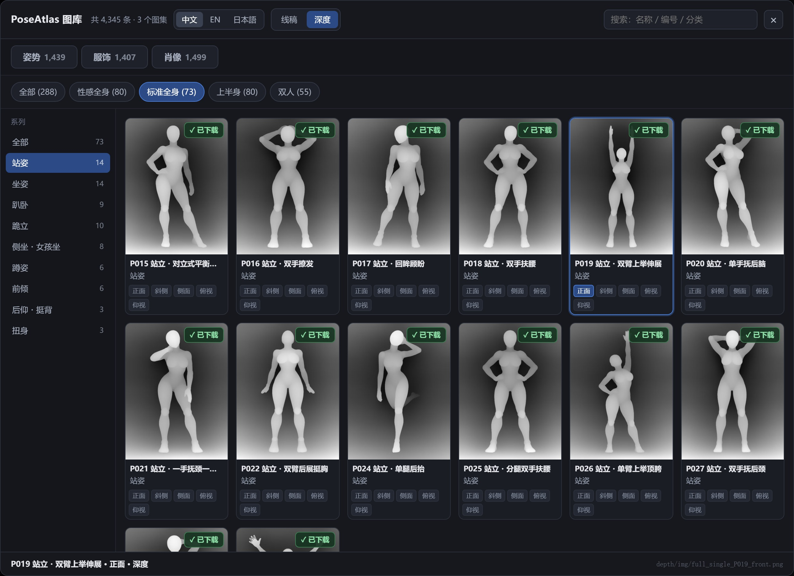
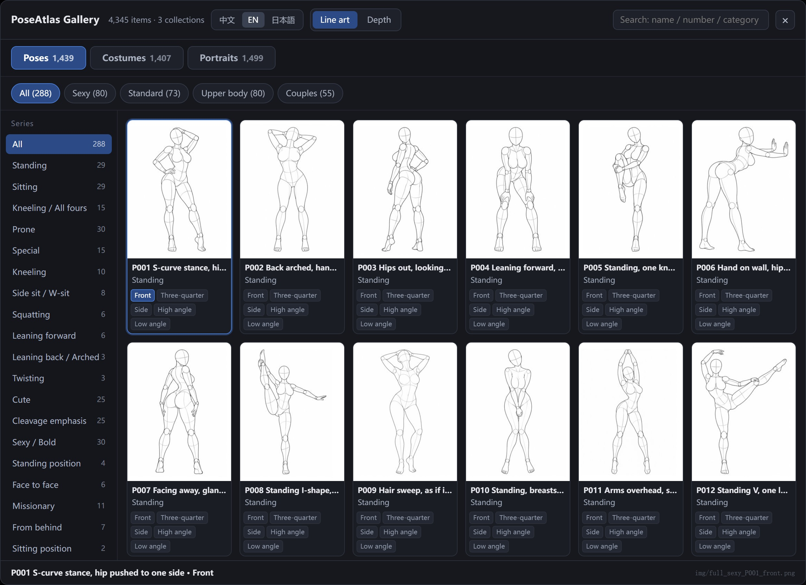
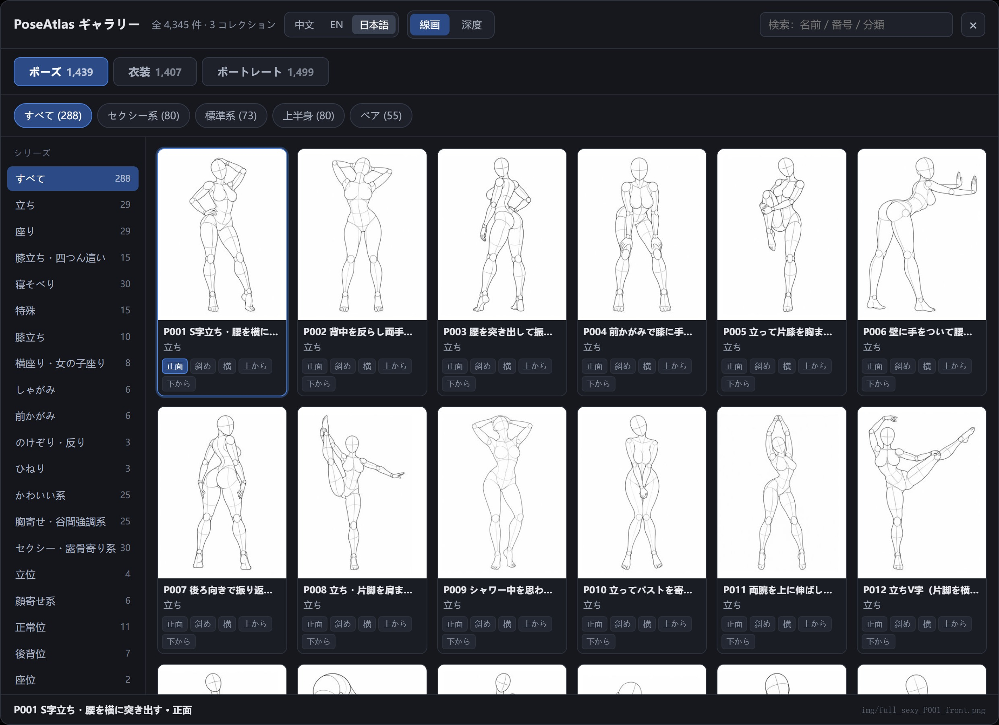
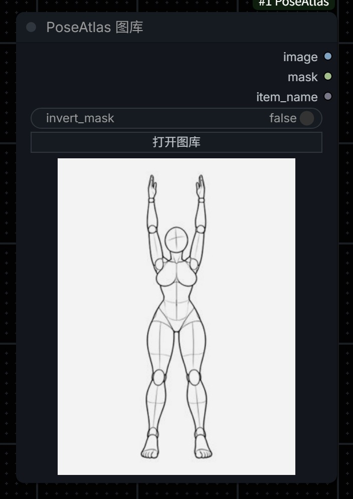
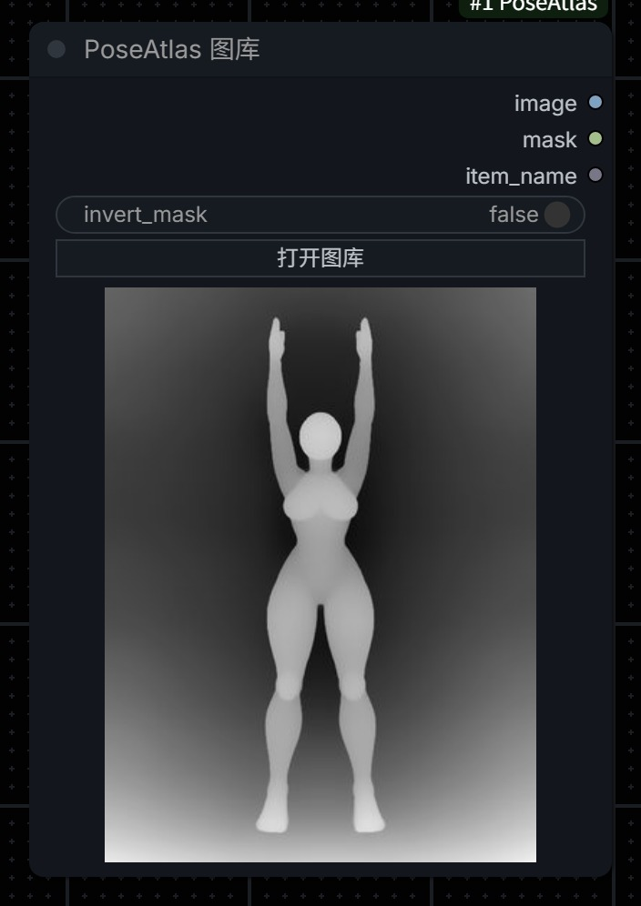
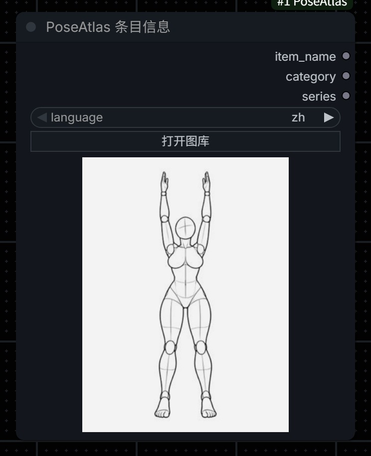

# ComfyUI-PoseAtlas

**中文** ｜ [English](README.en.md) ｜ [日本語](README.ja.md)

把 [RuiC-PoseAtlas](https://github.com/HRuiCcc/RuiC-PoseAtlas) 的**三套图集**做成 ComfyUI 节点：

| 图集 | 条目 | 规格 | 内容 |
|---|---|---|---|
| **姿势** | 1,439 | 900×1200 PNG | 288 组姿态 × 5 角度（正面 / 斜侧 / 侧面 / 俯视 / 仰视），两套渲染 |
| **服饰** | 1,407 | 1366×2048 WEBP | 按季节 × 品类 × 颜色组织，8 季 × 10 品类 |
| **肖像** | 1,499 | 全尺寸 PNG | 脸部 893 + 造型 606，按发型分 4 档 |

共 **4,345 条**，在图库里点一张，直接输出 `IMAGE`，接 ControlNet、接图生图、接编辑模型都行。

> ⚠️ **本仓库不含任何图片**——连缩略图也不带，一张都没有。
> 图片版权归原作者所有，装完请按「安装」第 3 步跑一次下载脚本（4,345 张缩略图约 59 MB）。



<details><summary>服饰 / 肖像 / 深度 图集</summary>







</details>

<details><summary>English / 日本語 interface</summary>





</details>

---

## 这是什么

RuiC-PoseAtlas 本身是一个静态参考图库。本项目把它的浏览体验搬进 ComfyUI：
不用切浏览器、不用手动找文件、不用记住 4,345 个文件名，搜索框里中/英/日都能搜。

**姿势集**每组提供 5 个视角，画面是无面部特征的灰色人台线稿，专门用来观察体块、比例、关节和镜头关系。
同一批 1,439 个变体（id 一一对应）还有一套**灰度深度渲染**，白色代表靠近镜头。
线稿适合抽骨架，深度图适合 ControlNet depth —— 双人姿势的前后遮挡关系在深度图里是分层的，这是线稿给不了的。

**v2.0 新增服饰集与肖像集**：服饰是 1366×2048 的整身穿搭图（换装 / 服装风格迁移的参考），
肖像是不带背景干扰的人物脸部与造型图（角色一致性、发型参考）。三套图集共用一个面板、一套搜索、一套三语名称。

| 图集 | 渲染 | 来源 | 适用 |
|---|---|---|---|
| 姿势 | 线稿 | [POSE-DB-01](https://ai-pose-gallery.pages.dev/) | 抽骨架、图生图、编辑模型 |
| 姿势 | 深度 | [POSE-DB-02](https://ai-pose-depth-gallery.pages.dev/) | ControlNet depth、需要前后关系的合成 |
| 服饰 | 原图 | RuiC-PoseAtlas | 换装、服装风格、搭配参考 |
| 肖像 | 原图 | RuiC-PoseAtlas | 角色一致性、发型 / 妆容参考 |

## 三语界面（中 / EN / 日本語）

面板标题栏右侧有语言切换，点一下整个界面跟着换：

| 位置 | 说明 |
|---|---|
| 界面文案 | 标题、搜索框、侧栏标题、按钮、提示语，共三套 |
| 条目名 | 姿态名、分类、角度；服饰的季节 / 品类 / 颜色；肖像的部位 / 发型 / 造型 |
| 搜索 | 三种语言的名称都能搜到同一个条目 |

**这些语言不是本项目的翻译**。上游 RuiC-PoseAtlas 的数据本身就同时提供 `zh` / `en` / `ja` 三种名称，
本项目只是把它们原样搬进 `index.json` 的 `labels` 字段，没有新增任何翻译。
（服饰的标签词与肖像的造型名上游给的是 key，译文在 `scripts/_i18n/` 里，由 `build_index.py` 拼进去。）

选择会记在浏览器 `localStorage`（键名 `poseatlas-node-lang`），下次打开保持上次的语言。

> **下拉框里存的值始终是中文串**（例如 `[性感全身] 站姿 / P001 ... / 正面`）。
> 这样做是为了让同一份工作流在任何界面语言下都能正常打开 —— 换语言只影响显示，不影响已保存的参数。

## 两个节点

### PoseAtlas 图库（`PoseAtlasLoader`）

| | |
|---|---|
| 输入 | `collection`（姿势 / 服饰 / 肖像）、`pose`（图库选择）、`render`（线稿 / 深度）、`invert_mask` |
| 输出 | `image` `IMAGE` · `mask` `MASK` · `item_name` `STRING` |

`collection` / `pose` / `render` 都是内部 UI 状态，由面板接管，节点上只露 `invert_mask` 和「打开图库」。
它们留着是因为 Python 端要靠这些值决定读哪套文件，删掉节点就不知道要哪个了。



深度模式下节点上直接画出深度缩略图，双人姿势的前后遮挡一眼可见：



点「打开图库」是全屏面板：

- **图集 tab**：姿势 1,439 / 服饰 1,407 / 肖像 1,499，切换即换整套数据
- **语言切换**：`中文 / EN / 日本語`
- **渲染切换**：`线稿 / 深度`（只对姿势集生效，其余图集置灰）
- **横向分类**：姿势按 4 系列（性感全身 80 / 标准全身 73 / 上半身 80 / 双人 55）× 26 子分类；
  服饰按 8 个季节；肖像按 脸部 / 造型
- **左侧分类**：随横向页签动态切换，计数按当前页签实时重算
- **缩略图网格**：姿势把同一姿态的 5 个角度合成一张卡片，卡内小标签切换角度
- **下载按钮**：深度模式下每张卡片右上角有 `↓ 原图`，点一下就把该角度的 900×1200 原图取回本地
- **搜索框**：中 / 英 / 日名称、编号、分类都能搜，自动跨图集检索
- **底部**：当前选中项的编号、名称、分类、文件路径

### PoseAtlas 条目信息（`PoseAtlasInfo`）

只要文字、不要图时用这个。输入 `collection` + `pose` + `language`（zh / en / ja），
输出 `item_name` / `category` / `series`，方便拼进提示词。



---

## 安装

### 1. 装节点

```bash
cd ComfyUI/custom_nodes
git clone https://github.com/mugicha-AI/ComfyUI-PoseAtlas.git
```

没有 git 的话，在 GitHub 页面点 `Code → Download ZIP`，解压到 `ComfyUI/custom_nodes/ComfyUI-PoseAtlas`。

### 2. 检查目录

装完应该是这样——**所有图片目录都是空的**（只有 `.gitkeep` 占位）：

```
ComfyUI/custom_nodes/ComfyUI-PoseAtlas/
├── __init__.py
├── scripts/
│   ├── download_images.py      图片下载脚本
│   ├── build_index.py          索引重建（改了元数据才需要跑）
│   └── _i18n/                  服饰标签 / 造型名的三语表
└── web/
    ├── poseatlas.js            图库面板前端
    └── atlas/
        ├── poses.json          288 组姿态元数据
        ├── costumes.json       1,407 套服饰元数据
        ├── faces.json          1,499 张肖像元数据
        ├── index.json          前端索引（4,345 条，含三语 labels）
        ├── img/                ← 空，姿势线稿原图
        ├── thumbs/             ← 空，姿势线稿缩略图
        ├── costume/{img,thumbs}   ← 空
        ├── portrait/{img,thumbs}  ← 空
        └── depth/{img,thumbs}     ← 空
```

### 3. 下载图片（必须做，否则图库是空的）

图片版权归原作者 **ギア (@giaaibusi)** 及其他原作者所有，本项目**不打包、不再分发**，
只提供脚本从公开源站取回：

```bash
cd ComfyUI/custom_nodes/ComfyUI-PoseAtlas
python scripts/download_images.py                # 只下缩略图，约 59 MB（先跑这个）
python scripts/download_images.py --full         # 连全尺寸原图，约 5.4 GB
```

| 命令 | 拿到什么 | 体积 |
|---|---|---|
| `python scripts/download_images.py` | 4,345 张缩略图（姿势 / 服饰 / 肖像三套） | 约 59 MB |
| `python scripts/download_images.py --full` | 上面全部 + 姿势线稿、服饰、肖像的全尺寸原图 | 约 5.4 GB |
| `python scripts/download_images.py --only costume` | 只处理某一套（`pose` / `costume` / `portrait`） | — |
| `python scripts/download_images.py --dry-run` | 只统计缺多少，不下载 | — |
| `python scripts/download_images.py --workers 12` | 并发数（默认 8） | — |

- 每套都会在多个镜像间自动切换（`raw.githubusercontent` → `jsdelivr` → `ghfast` → `gh-proxy`），某个超时就换下一个
- 中断了直接重跑，已下载的会跳过，自动续传
- 下载前会校验文件头，源站返回错误页时不会存成假图片
- 只想看某一部分：`--only pose` 最快（缩略图 22 MB）

### 4. 深度原图（按需，不批量）

深度图这一套是**例外**：源站明确写着

> 「このデータベースの画像を一括でダウンロードすること（ツール等による自動取得を含む）と、
> 取得した画像の再配布・転載・販売は禁止です」

所以下载脚本**不下载深度原图**，也不提供批量抓取。用法是在面板里切到「深度」，
点卡片右上角的 **`↓ 原图`**，服务端会从源站取回**你点的那一张** 900×1200 原图，
写入 `web/atlas/depth/img/`，同时自动缩出一张 300×400 缩略图放进 `depth/thumbs/`；此后一直用本地的。

逐张按需取回属于「生成时参考一张」的用法，批量抓取则不是。请只点你真正要用的那几张。

> 深度缩略图是下载原图时顺带生成的，不是仓库自带的。
> 换机器或者想补缩略图，用 `python scripts/download_images.py --only depth-thumbs`
> 把所有**本地已有**的深度原图重新缩一遍（不联网）。

### 5. 重启 ComfyUI

节点出现在右键菜单的 **`PoseAtlas`** 分类下，或双击画布搜索 `PoseAtlas`。

> **改过 `web/` 下的文件后要 Ctrl+F5 强制刷新**，否则浏览器用的还是旧版前端。

---

## 怎么用

### 最基本的用法：直接出图

拖一个 **PoseAtlas 图库**，点「打开图库」选一张，`image` 输出接到任何吃 `IMAGE` 的节点。

### 配合 ControlNet 出图（推荐）

人台线稿 → 抽骨架 → ControlNet → 出图。本机实测这套参数可用：

```
PoseAtlas 图库（collection=姿势, render=线稿）
   └─ image → PoseAndFaceDetection → DrawViTPose → ControlNetApplyAdvanced
                                                     ├─ control_net: xinsir_cn_union_sdxl_1.0_promax
                                                     ├─ strength: 0.65
                                                     └─ end_percent: 0.85
                                                        └─ KSampler → VAEDecode → 保存图像
```

**关键参数**：

| 参数 | 值 | 说明 |
|---|---|---|
| `PoseAndFaceDetection` 的 width/height | **必须与出图分辨率同比例** | 喂 3:4 的图却填 832×480，腿会被截断 |
| ControlNet strength | `0.65` | 0.9 会得到线稿风，太低会丢姿势 |
| end_percent | `0.85` | 让模型后段自由发挥质感 |
| 负面词 | 加 `stick figure, sketch, lineart` | 防止它照着骨架画线 |

抽骨架节点来自 [ComfyUI-WanAnimatePreprocess](https://github.com/kijai/ComfyUI-WanAnimatePreprocess)（自带 ViTPose ONNX，不用额外装 controlnet_aux）。
没有这个节点的话，直接把 `image` 当参考图喂给图生图 / 编辑模型也可以。

### 用深度图做 ControlNet depth

在面板里把渲染切到「深度」，`image` 直接进深度 ControlNet 的 image 输入（不需要再过深度预处理器，
图本身就是深度图）。白色是近处、深灰是远处，和常见深度 ControlNet 的约定一致。

双人姿势建议用深度版：线稿抽骨架会被 ViTPose 只检出一个人，而深度图保留两个人的前后关系，
直接喂 depth ControlNet 或用它做景深合成都不会丢人。

### 用服饰集做换装

服饰集是整身穿搭图，接在编辑模型（Qwen-Image / Flux Kontext / Krea2）的参考图输入上：

```
PoseAtlas 图库（collection=服饰） → image → TextEncodeQwenImage21 的 images.image_2
PoseAtlas 图库（collection=姿势） → image → TextEncodeQwenImage21 的 images.image_1   ← 姿态
```

提示词里写「把 `<image2>` 的衣服穿到 `<image1>` 的人物身上，保持 `<image1>` 的姿态和身体比例」。
服饰图本身带模特，**要的是衣服不是人**时，提示词里明确写「只取服装款式与配色，人物身份以 `<image1>` 为准」。

### 用肖像集做角色一致性

肖像集是干净的脸部 / 造型图，适合当人脸参考：

```
PoseAtlas 图库（collection=肖像, section=脸部） → image → 参考图输入
```

配合姿势集时，`image_1` 给姿势、`image_2` 给人脸，再在提示词里分别指认。
**注意**：人台本身胸腰比夸张，出的真人会偏壮，提示词里补一句「改成正常人体比例」。

### 示例工作流

`examples/` 下有 8 个工作流，拖进 ComfyUI 或从菜单 `工作流 → 打开` 载入。
同名的 `.png` 是工作流全景图，可以先看效果再决定载入哪个：

| 文件 | 用到的图集 | 链路 | 底模 |
|---|---|---|---|
| `basic_loader.json` | 姿势 | 图库 → 保存图像（最小示例） | 无 |
| `Flux3Klein-PoseAtlas.json` | 姿势 | 图库 + 参考图 → 提示词自动改写 → 出图 → 对比输出 | Flux3 Klein |
| `QW2.1-PoseAtlas.json` | 姿势 | 图库 + 参考图 → 提示词自动改写 → 编辑出图 → 对比输出 | Qwen-Image 2.1 |
| `Flux3Klein-换装-PoseAtlas.json` | 服饰 | 服饰 + 人物参考 → 换装出图 | Flux3 Klein |
| `QW2.1-换装-PoseAtlas.json` | 服饰 | 服饰 + 人物参考 → 换装出图 | Qwen-Image 2.1 |
| `QW2.1-PoseAtlas-Assembly.json` | 姿势 + 服饰 + 肖像 | **三图集联动**：姿态 / 服装 / 人脸各取一张 → 组合出图 | Qwen-Image 2.1 |
| `Mugicha_Krea2_depth.json` | 姿势（深度） | 深度图 → Krea2 ControlNet → 出图 | Krea2 |
| `Mugicha_MossImage_depth.json` | 姿势（深度） | 深度图 → MossImage Control → 出图 | MossImage |

注意事项：

- 依赖 `rgthree-comfy`、`comfyui-easy-use`、`ComfyUI-WanAnimatePreprocess` 等常见自定义节点，缺什么 ComfyUI 会红框提示
- 工作流里的模型文件名是我本机的量化版命名（如 `qwen_image_2.1_int8_convrot`），导入后请换成你自己下载的对应模型
- 配套 LoRA 不同：姿势 / 组合类用 `Qwen-Image-2.1-multiple_angles`（增强多角度姿态跟随），
  换装类用 `Qwen-Image-2.1-outfit-swap`，深度类用各自的 depth-control LoRA。没有就删掉该节点

---

## 没有本地 GPU？

这个节点本身很轻（只读图，不跑模型），但配套的 ControlNet / 编辑模型需要显存。
手头没有能跑 ComfyUI 的机器时，可以用云端 ComfyUI：

| 平台 | 特点 |
|---|---|
| [RunningHub](https://www.runninghub.ai/?inviteCode=rh-v1603) | 云端 ComfyUI，跑在线工作流，不用自己装环境 |
| [ZZAI 真真AI](https://www.zzai.app/?aff=bFpY) | 一站式 AI 创作平台，画布 Agent 一句话搭流程，兼容 OpenAI 的 API 接入 |

> 以上链接含邀请码，通过它注册我会获得一点返利，不影响你的使用成本。
> 不通过链接直接访问官网同样可用。

---

## 已知限制

| 限制 | 原因 | 建议 |
|---|---|---|
| **仓库里一张图都没有** | 版权归原作者，不再分发 | 装完先跑 `python scripts/download_images.py`（约 59 MB） |
| **双人系列（55 组）抽骨架只检出一个人** | ViTPose 单人检测 | 用深度图走 depth ControlNet，或直接把 `image` 当参考图喂编辑模型 |
| 深度原图要逐张点下载 | 源站禁止批量抓取 | 只下真正要用的；批量下载脚本不提供是刻意的 |
| 深度缩略图要先有原图 | 缩略图由原图实时缩出 | 点「↓ 原图」会自动连缩略图一起生成 |
| 人台图没有 alpha 通道 | 原图是 RGB PNG | `mask` 输出全 1，只有 `invert_mask` 可用 |
| 图库面板需要浏览器端加载 | 前端从 `/extensions/` 读数据 | 首次打开有约 1 秒加载，之后有缓存 |
| 肖像全尺寸很大 | 1,499 张 PNG 共约 4.6 GB | 空间不够就只下缩略图（不加 `--full`） |
| 第三方翻译插件会改面板文字 | 它按硬编码词典替换英文 | 面板已标 `.notranslate`；若插件不认，可更新 `ComfyUI-DD-Translation` 让它遵守该约定 |

## 内容提示

原图库的分类里包含成人向内容（「性感・大胆系」「内衣」「泳装」「性感」等），面向成年创作者。
请遵守所在地法律法规与平台规范。

---

## 版权与许可

| 对象 | 许可 |
|---|---|
| 本项目代码（`__init__.py`、`web/poseatlas.js`、`scripts/*`） | **MIT** |
| 姿势线稿、深度图、服饰图、肖像图、原始数据、名称（含三语名称） | **版权归原作者 ギア (@giaaibusi)**，不在 MIT 范围内 |

原作者允许将作品用于创作（含商用、编辑、参考），但**禁止再分发、转载、转售图片数据本身**。
所以本仓库一张图都不带，只带元数据、索引和下载脚本。如果你 fork 本项目，请保持同样的做法。

- 原作 / 线稿站点：[POSE-DB-01](https://ai-pose-gallery.pages.dev/)
- 深度站点：POSE-DB-02 <https://ai-pose-depth-gallery.pages.dev/>
- 原作者：[ギア (@giaaibusi)](https://x.com/giaaibusi)
- 数据整理与前端：[RuiC-PoseAtlas](https://github.com/HRuiCcc/RuiC-PoseAtlas) by [HRuiCcc](https://github.com/HRuiCcc)

本项目为非官方整理，与原作者及 RuiC-PoseAtlas 作者均无隶属关系。
若原作者认为本仓库侵犯其权益，请通过 [Issue](https://github.com/mugicha-AI/ComfyUI-PoseAtlas/issues) 联系，将立即删除相关内容。

---

## 致谢

- 姿势线稿、深度图与原始数据：ギア (@giaaibusi)
- 数据整理、三语名称、图库前端：HRuiCcc / RuiC-PoseAtlas
- 抽骨架节点：kijai / ComfyUI-WanAnimatePreprocess

## 视频介绍

我做了几期视频讲这个节点的用法，挑一个平台看：

| 平台 | 链接 |
|---|---|
| Bilibili（中文） | [PoseAtlas 实测：1439 张多角度人台线稿，我把它做成了 ComfyUI 节点](https://www.bilibili.com/video/BV1CFxi6uEhk/) |
| YouTube | [PoseAtlas 实测：1439 张多角度人台线稿，我把它做成了 ComfyUI 节点](https://www.youtube.com/watch?v=3_gDBeM9o6U) |

```
PoseAtlas 实测：1439 张多角度人台线稿，我把它做成了 ComfyUI 节点
```

视频里覆盖：图库面板怎么用、深度图和线稿的差别、接 ControlNet 抽骨架的实际参数，
以及双人姿势为什么建议走深度。文字版见上面的「怎么用」。

## 关于作者

- GitHub：[@mugicha-AI](https://github.com/mugicha-AI)
- 更多 ComfyUI 相关工作流与教程会陆续发在这里

如果这个节点帮你省了找参考图的时间，欢迎点个 ⭐ Star。

## License

代码部分 MIT，见 [LICENSE](LICENSE)。图片不在许可范围内。
