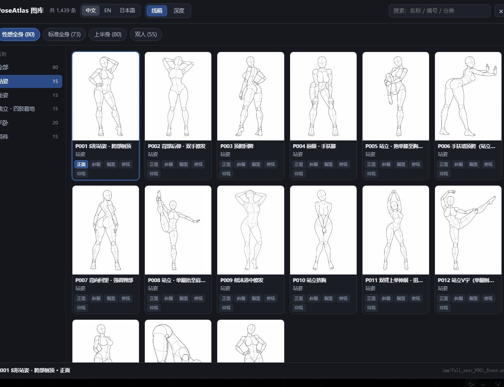
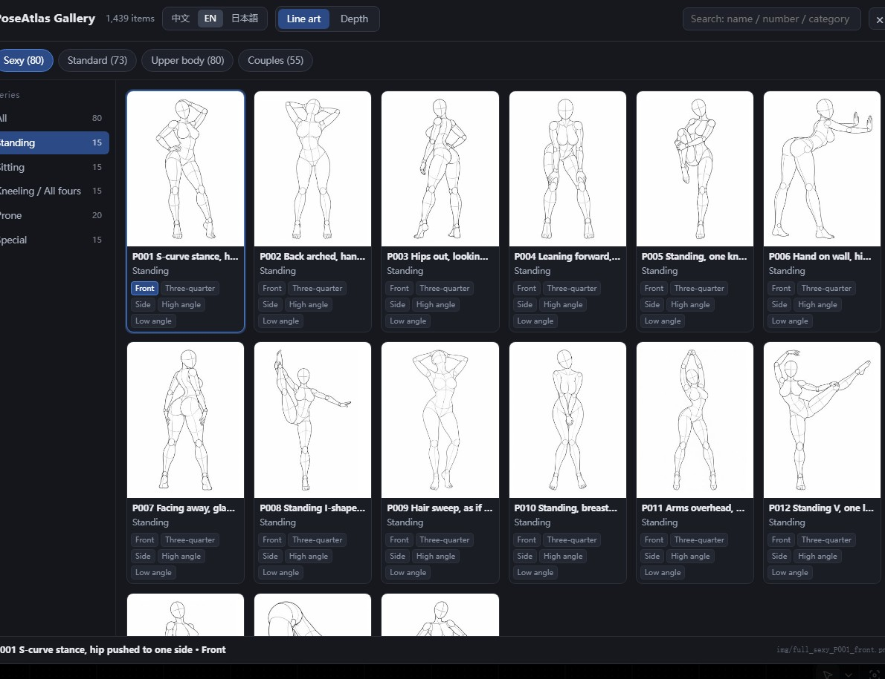
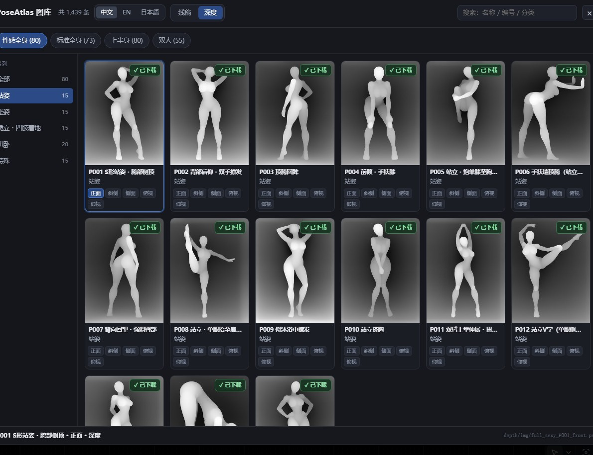
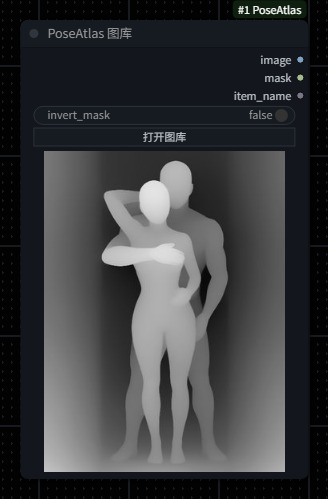

# ComfyUI-PoseAtlas

**中文** ｜ [English](README.en.md) ｜ [日本語](README.ja.md)

把 [RuiC-PoseAtlas](https://github.com/HRuiCcc/RuiC-PoseAtlas) 的 **288 组人体姿态 / 1439 张多角度参考图** 做成了 ComfyUI 节点。
每个姿态有两种渲染可选：**人台线稿**（POSE-DB-01）和**灰度深度图**（POSE-DB-02）。
在图库里点一张图，直接输出 `IMAGE`，接 ControlNet、接图生图、接编辑模型都行。

> ⚠️ **本仓库不含全尺寸原图**。图片版权归原作者所有，请按下方「安装」第 3 步下载。
> 深度缩略图已随仓库提供（10.7 MB），开箱即可浏览；深度原图在面板里点「↓ 原图」逐张取回。



<details><summary>English / 日本語 interface</summary>




</details>

<details><summary>深度图界面</summary>



深度模式下每张卡片右上角是 **`↓ 原图`**，点一下取回该角度的 900×1200 原图；已下载的显示 **`✓ 已下载`**。

</details>

---

## 这是什么

RuiC-PoseAtlas 本身是一个静态姿态参考图库：每组姿态提供 **正面 / 斜侧 / 侧面 / 俯视 / 仰视** 五个视角，
画面是无面部特征的灰色人台线稿，专门用来观察体块、比例、关节和镜头关系。

本项目把它的浏览体验搬进 ComfyUI：不用切浏览器、不用手动找文件、不用记住 1439 个文件名。

**v1.1 新增深度图**：同一批 1439 个变体（id 一一对应）多了一套灰度深度渲染，白色代表靠近镜头。
线稿适合抽骨架，深度图适合 ControlNet depth —— 双人姿势的前后遮挡关系在深度图里是分层的，
这是线稿给不了的。

| 渲染 | 来源 | 规格 | 适用 |
|---|---|---|---|
| 线稿 | [POSE-DB-01](https://ai-pose-gallery.pages.dev/) | 900×1200 PNG | 抽骨架、图生图、编辑模型 |
| 深度 | [POSE-DB-02](https://ai-pose-depth-gallery.pages.dev/) | 900×1200 灰度 PNG | ControlNet depth、需要前后关系的合成 |

## 三语界面（中 / EN / 日本語）

面板标题栏右侧有语言切换，点一下整个界面跟着换：

| 位置 | 说明 |
|---|---|
| 界面文案 | 标题、搜索框、侧栏标题、按钮、提示语，共三套 |
| 条目名 | 姿态名、分类、角度；系列名与缩写 |
| 搜索 | 三种语言的名称都能搜到同一个条目 |

**这些语言不是本项目的翻译**。上游 RuiC-PoseAtlas 的数据本身就同时提供 `zh` / `en` / `ja` 三种名称
（`poses.json` 里每个姿态都带 `names.zh / .en / .ja`），本项目只是把它们原样搬进 `index.json` 的
`labels` 字段，没有新增任何翻译。

选择会记在浏览器 `localStorage`（键名 `poseatlas-node-lang`），下次打开保持上次的语言。

> **下拉框里存的值始终是中文串**（例如 `[性感全身] 站姿 / P001 ... / 正面`）。
> 这样做是为了让同一份工作流在任何界面语言下都能正常打开 —— 换语言只影响显示，不影响已保存的参数。

## 两个节点

### PoseAtlas 图库（`PoseAtlasLoader`）

| | |
|---|---|
| 输入 | `pose`（图库选择）、`render`（线稿 / 深度）、`invert_mask` |
| 输出 | `image` `IMAGE` · `mask` `MASK` · `item_name` `STRING` |

节点上只露 `invert_mask` 和「打开图库」两个控件 —— `pose` / `render` 都是内部 UI 状态，
由面板接管；`render` 留着是因为 Python 端要靠它的值决定读 `img/` 还是 `depth/img/`，
删掉节点就不知道要哪套了。


深度模式下节点上直接画出深度缩略图，双人姿势的前后遮挡一眼可见：



点「打开图库」是全屏面板：

- **语言切换**：`中文 / EN / 日本語`
- **渲染切换**：`线稿 / 深度`，切换后所有缩略图一起换
- **顶部 4 个系列**：性感全身(80) / 标准全身(73) / 上半身(80) / 双人(55)
- **左侧分类**：随系列动态切换，共 26 个子分类（站姿、坐姿、趴卧、跪立・四肢着地、蹲姿、前倾、扭身……）
- **缩略图网格**：同一姿态的 5 个角度合成一张卡片，卡内小标签切换 正面 / 斜侧 / 侧面 / 俯视 / 仰视
- **下载按钮**：深度模式下每张卡片右上角有 `↓ 原图`，点一下就把该角度的 900×1200 原图取回本地
- **搜索框**：中 / 英 / 日名称、编号、分类都能搜，自动跨系列检索
- **底部**：当前选中项的编号、名称、角度、文件路径

### PoseAtlas 条目信息（`PoseAtlasInfo`）

只要文字、不要图时用这个。输入 `pose` + `language`（zh / en / ja），输出 `item_name` / `category` / `series`，方便拼进提示词。


---

## 安装

### 1. 装节点

```bash
cd ComfyUI/custom_nodes
git clone https://github.com/mugicha-AI/ComfyUI-PoseAtlas.git
```

没有 git 的话，在 GitHub 页面点 `Code → Download ZIP`，解压到 `ComfyUI/custom_nodes/ComfyUI-PoseAtlas`。

### 2. 检查目录

装完应该是这样（此时 `img/`、`thumbs/`、`depth/img/` 是空的，`depth/thumbs/` 已经有 1439 张）：

```
ComfyUI/custom_nodes/ComfyUI-PoseAtlas/
├── __init__.py
├── scripts/
│   ├── download_images.py
│   └── build_index.py
└── web/
    ├── poseatlas.js
    └── atlas/
        ├── poses.json            ← 姿态元数据（三语名称/分类/角度）
        ├── index.json            ← 前端索引（含三语 labels 与深度路径）
        ├── img/                  ← 空，等你下载
        ├── thumbs/               ← 空，等你下载
        └── depth/
            ├── img/              ← 空，深度原图按需下载
            └── thumbs/           ← 1439 张 300×400，随仓库提供
```

### 3. 下载线稿图片（必须做，否则线稿是空的）

线稿图片版权归原作者 **ギア (@giaaibusi)** 所有，本项目**不打包、不再分发**全尺寸图片，
只提供脚本从原作者的公开仓库下载。

```bash
cd ComfyUI/custom_nodes/ComfyUI-PoseAtlas
python scripts/download_images.py
```

- 共 **2878 个文件**（1439 张 PNG 原图 + 1439 张缩略图），约 **660 MB**
- 会自动在 6 个镜像间切换，某个超时就换下一个
- 中断了直接重跑，已下载的会跳过，自动续传
- 只想先看看界面：`python scripts/download_images.py --thumbs-only`（约 22 MB）

### 4. 深度原图（按需，不批量）

深度图的**缩略图已经在仓库里**，装完就能在面板里看到全部 1439 张、能选、能输出（300×400）。
要 900×1200 原图的话，在面板里切到「深度」模式，点卡片右上角的 **`↓ 原图`**，
服务端会从源站取回该张并写入 `web/atlas/depth/img/`，此后一直用本地的。

> 这里**不提供批量下载脚本**，是刻意的：源站明确写着
> 「このデータベースの画像を一括でダウンロードすること（ツール等による自動取得を含む）と、
> 取得した画像の再配布・転載・販売は禁止です」。逐张按需取回属于「生成时参考一张」的用法，
> 批量抓取则不是。请只点你真正要用的那几张。
>
> 原图没下载时，节点会自动退回用缩略图输出，`item_name` 后面会标注「深度缩略图，原图未下载」，
> 所以不下载也能跑通流程，只是分辨率低。

### 5. 重启 ComfyUI

节点出现在右键菜单的 **`PoseAtlas`** 分类下，或双击画布搜索 `PoseAtlas`。

> **改过 `web/` 下的文件后要 Ctrl+F5 强制刷新**，否则浏览器用的还是旧版前端。

---

## 怎么用

### 最基本的用法：直接出图

拖一个 **PoseAtlas 图库**，点「打开图库」选一张，`image` 输出接到任何吃 `IMAGE` 的节点。

### 配合 ControlNet 出图（推荐）

人台线稿 → 抽骨架 → ControlNet → 出图。本机实测这套参数可用：

```
PoseAtlas 图库（render=线稿）
   └─ image → PoseAndFaceDetection → DrawViTPose → ControlNetApplyAdvanced
                                                     ├─ control_net: xinsir_cn_union_sdxl_1.0_promax
                                                     ├─ strength: 0.65
                                                     └─ end_percent: 0.85
                                                        └─ KSampler → VAEDecode → 保存图像
```

**关键参数**：

| 参数 | 值 | 说明 |
|---|---|---|
| `PoseAndFaceDetection` 的 width/height | **必须与出图分辨率同比例** | 喂 3:4 的图却填 832×480，腿会被截断 |
| ControlNet strength | `0.65` | 0.9 会得到线稿风，太低会丢姿势 |
| end_percent | `0.85` | 让模型后段自由发挥质感 |
| 负面词 | 加 `stick figure, sketch, lineart` | 防止它照着骨架画线 |

抽骨架节点来自 [ComfyUI-WanAnimatePreprocess](https://github.com/kijai/ComfyUI-WanAnimatePreprocess)（自带 ViTPose ONNX，不用额外装 controlnet_aux）。
没有这个节点的话，直接把 `image` 当参考图喂给图生图 / 编辑模型也可以。

### 用深度图做 ControlNet depth

在面板里把渲染切到「深度」，`image` 直接进深度 ControlNet 的 image 输入（不需要再过深度预处理器，
图本身就是深度图）。白色是近处、深灰是远处，和常见深度 ControlNet 的约定一致。

双人姿势建议用深度版：线稿抽骨架会被 ViTPose 只检出一个人，而深度图保留两个人的前后关系，
直接喂 depth ControlNet 或用它做景深合成都不会丢人。

### 配合 Qwen-Image 2.1 编辑

人台线稿本身就是"编辑"语义，把它当参考图能让模型保留姿态重绘质感：

```
PoseAtlas 图库 → image → TextEncodeQwenImage21 的 images.image_1
```

提示词里明确写「保持相同的站姿、身体比例和镜头角度」，再描述想要的外观。
**注意**：人台本身胸腰比夸张，出的真人会偏壮，提示词里补一句「改成正常人体比例」。

### 示例工作流

`examples/` 下有三个工作流，拖进 ComfyUI 或从菜单 `工作流 → 打开` 载入：

| 文件 | 链路 | 底模 |
|---|---|---|
| `basic_loader.json` | 图库 → 保存图像（最小示例） | 无 |
| `Flux3Klein-PoseAtlas.json` | 图库 + 参考图 → 提示词自动改写 → 出图 → 原图/结果对比输出 | Flux3 Klein |
| `QW2.1-PoseAtlas.json` | 图库 + 参考图 → 提示词自动改写 → 编辑出图 → 原图/结果对比输出 | Qwen-Image 2.1 |

两个完整示例的工作方式相同：`PoseAtlasLoader` 提供姿态线稿，再喂 1–2 张角色/风格参考图，
先走一遍提示词改写 LLM 把姿态描述写进提示词，然后出图，最后把「参考图 | 生成结果」拼在一起保存。

注意事项：

- 依赖 `rgthree-comfy`、`comfyui-easy-use` 等常见自定义节点，缺什么 ComfyUI 会红框提示
- 工作流里的模型文件名是我本机的量化版命名（如 `qwen_image_2.1_int8_convrot`），导入后请换成你自己下载的对应模型
- 两个示例都加载了 `multiple_angles` LoRA（增强多角度姿态跟随），没有的话可以去掉该节点

---

## 没有本地 GPU？

这个节点本身很轻（只读图，不跑模型），但配套的 ControlNet / 编辑模型需要显存。
手头没有能跑 ComfyUI 的机器时，可以用云端 ComfyUI：

| 平台 | 特点 |
|---|---|
| [RunningHub](https://www.runninghub.ai/?inviteCode=rh-v1603) | 云端 ComfyUI，跑在线工作流，不用自己装环境 |
| [ZZAI 真真AI](https://www.zzai.app/?aff=bFpY) | 一站式 AI 创作平台，画布 Agent 一句话搭流程，兼容 OpenAI 的 API 接入 |

> 以上链接含邀请码，通过它注册我会获得一点返利，不影响你的使用成本。
> 不通过链接直接访问官网同样可用。

---

## 已知限制

| 限制 | 原因 | 建议 |
|---|---|---|
| **双人系列（55 组）抽骨架只检出一个人** | ViTPose 单人检测 | 用深度图走 depth ControlNet，或直接把 `image` 当参考图喂编辑模型 |
| 深度原图要逐张点下载 | 源站禁止批量抓取 | 只下真正要用的；不下也能用缩略图跑通 |
| 深度缩略图是 300×400 | 仓库只带缩略图 | 做正式出图前先点「↓ 原图」拿 900×1200 |
| 人台图没有 alpha 通道 | 原图是 RGB PNG | `mask` 输出全 1，只有 `invert_mask` 可用 |
| 图库面板需要浏览器端加载 | 前端从 `/extensions/` 读数据 | 首次打开有约 1 秒加载，之后有缓存 |
| 第三方翻译插件会改面板文字 | 它按硬编码词典替换英文 | 面板已标 `.notranslate`；若插件不认，可更新 `ComfyUI-DD-Translation` 让它遵守该约定 |

## 内容提示

原图库 26 个分类里包含成人向内容（「性感・大胆系」「正常位」等），面向成年创作者。
请遵守所在地法律法规与平台规范。

---

## 版权与许可

| 对象 | 许可 |
|---|---|
| 本项目代码（`__init__.py`、`web/poseatlas.js`、`scripts/*`） | **MIT** |
| 姿态线稿、深度图、原始数据、名称（含三语名称） | **版权归原作者 ギア (@giaaibusi)**，不在 MIT 范围内 |
| 深度缩略图（随仓库的 1439 张） | 同上，仅作浏览索引，不建议再分发 |

原作者允许将作品用于创作（含商用、编辑、参考），但**禁止再分发、转载、转售图片数据本身**。
所以本仓库只带缩略图和下载脚本，不打包全尺寸原图。如果你 fork 本项目，请保持同样的做法。

- 原作 / 线稿站点：[POSE-DB-01](https://ai-pose-gallery.pages.dev/)
- 深度站点：POSE-DB-02 <https://ai-pose-depth-gallery.pages.dev/>
- 原作者：[ギア (@giaaibusi)](https://x.com/giaaibusi)
- 数据整理与前端：[RuiC-PoseAtlas](https://github.com/HRuiCcc/RuiC-PoseAtlas) by [HRuiCcc](https://github.com/HRuiCcc)

本项目为非官方整理，与原作者及 RuiC-PoseAtlas 作者均无隶属关系。
若原作者认为本仓库侵犯其权益，请通过 [Issue](https://github.com/mugicha-AI/ComfyUI-PoseAtlas/issues) 联系，将立即删除相关内容。

---

## 致谢

- 姿态线稿、深度图与原始数据：ギア (@giaaibusi)
- 数据整理、三语名称、图库前端：HRuiCcc / RuiC-PoseAtlas
- 抽骨架节点：kijai / ComfyUI-WanAnimatePreprocess

## 关于作者

- GitHub：[@mugicha-AI](https://github.com/mugicha-AI)
- 更多 ComfyUI 相关工作流与教程会陆续发在这里

如果这个节点帮你省了找参考图的时间，欢迎点个 ⭐ Star。

## License

代码部分 MIT，见 [LICENSE](LICENSE)。图片不在许可范围内。
